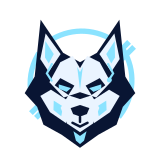

# WOLF OVERRIDE

WOLF OVERRIDE is a game project by Nathanial Henniges and MrDemonWolf, Inc. The project has returned to story development. Its Godot entry scene is empty.

## Project files

- [Current handoff](docs/next-session.md)
- [Godot project](apps/game/project.godot)
- [Website and project guide](https://wolfoverride.mrdemonwolf.dev/)
- [Retired prototype and its guides](https://github.com/MrDemonWolf/wolf-override/tree/b4d15656)
- [Asset provenance](apps/game/assets/manifest.json)

## License

- **Code and docs:** Copyright 2026 MrDemonWolf, Inc., under
  [GPL-3.0-or-later](LICENSE).
- **Fonts:** Roboto, Montserrat and the Noto Sans CJK subsets use the
  SIL Open Font License 1.1, with the license text beside each copy.
- **Historical art:** the provisional logo, sprites, title art, room plates and
  station props are separate assets with AI-assisted provenance in
  [the asset register](apps/game/assets/manifest.json). They are not
  covered by the GPL, and their final rights review is open.
- **Design-note images:** the concept art, mock-ups and game captures
  in the design notes (now in git history; see `docs/NOTES.md`) have
  the same status.
- **Historical sound:** the processed sound recordings are CC0, credited on the
  credits page.
- **Branding:** the MrDemonWolf, Inc. logo and mascot are the company's
  branding, all rights reserved, and are not covered by the GPL.
- **Privacy:** the game sends nothing over the network. The
  [privacy page](https://wolfoverride.mrdemonwolf.dev/docs/privacy/)
  lists what the game and site store and how to remove it.

[Legal and licensing](https://wolfoverride.mrdemonwolf.dev/docs/legal/)
has the full details.

## Contact

- [Open an issue](https://github.com/MrDemonWolf/wolf-override/issues)
- [Report a security problem privately](SECURITY.md)
- [Join my server](https://mrdwolf.net/discord)
- [MrDemonWolf, Inc.](https://www.mrdemonwolf.com)

Made with love by [MrDemonWolf, Inc.](https://www.mrdemonwolf.com)
