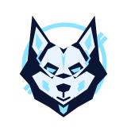
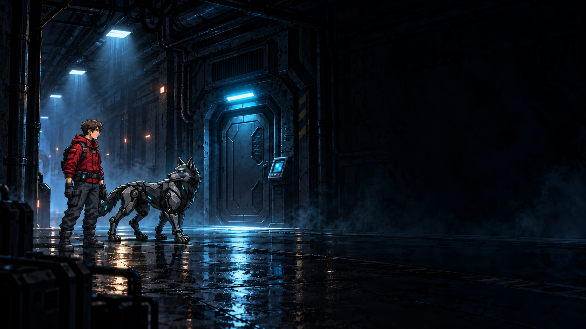

# WOLF OVERRIDE - Wake up. Choose who to trust.



WOLF OVERRIDE is a side-view 2D sci-fi game in development. WOLF, a
robotic wolf, wakes himself after overhearing the Program Director's plan
to use him as a deniable killer under the cover of protecting people. You
play the engineer who meets him; together you preserve evidence, protect
people and look for a way out while WOLF keeps his own will.

One choice can change what your companion remembers.



**Status:** development version `0.15.0`, one chapter slice.

- **Runs from source** in Godot 4.7.2. There is no installer, store
  release or release date.
- **Test builds:** unsigned macOS and Windows debug builds are made
  from each change for testers and kept for 14 days. They are not
  releases.
- **How it was checked:** headless checks pass and rendered stills
  were inspected. No complete route has been played by hand, so feel,
  timing and sound are unvalidated.
- **Not tested:** controller hardware, touch devices, and opening an
  export on a Mac or a Windows PC.

## Features

- **One playable engineer** - Move through three side-view rooms: a
  maintenance corridor, Records Access and the Service Junction.
- **An independent companion** - WOLF follows, takes his own tasks and
  can refuse. You never control him.
- **Cooperation with a fallback** - Open a powered door together, or
  hold interact to crank the engineer's manual bypass yourself.
- **A remembered choice** - One authored disagreement records your
  reply, and WOLF recalls it at the safe point.
- **A first records objective** - Copy a purge-order trace and a
  mirror timestamp through WOLF's readout or a maintenance port.
- **The Service Junction** - No weapon, only the building: a valve, a
  door blast on a short fuse, a hanging tank and a patrolling sentry.
  The engineer can always finish it alone.
- **Real doors** - Records Access and the Service Junction have doors
  that swing, slide or are blown open and stand across the walkway
  while shut.
- **Knockdown and retry** - Junction hazards knock the engineer down.
  Play resumes from the room's last automatic save with choices intact.
- **An end card** - Leaving the junction ends the slice on an END OF
  SLICE card that recaps your choices.
- **Impact and sound** - Big moments get a short sound, a brief camera
  shake, sparks or dust and controller or phone rumble.
- **Accessibility settings** - Reduced Motion turns off the shake
  and hit-stop and shortens flashes. Text Size enlarges dialogue and hints. Toggle
  Holds turns every crank into press to start, press again to stop.
- **Saves** - The safe point, every Records Access station and the
  junction's stages save; Continue restores the room and your choices.
- **Input and settings** - Keyboard, controller and touch, six
  rebindable actions, FPS limit, V-sync, MSAA, window size and audio.
- **In-game changelog** - The title screen's Changelog shows these
  development updates, and the title shows the version number.
- **Debug tools** - An overlay, zone drawing and an F12 bug capture
  for testers.

The rooms and characters use provisional AI-assisted art, and most
sounds are generated in code (a few are processed CC0 recordings).
There is no music yet. More languages and more chapters are planned;
only English is offered today.

## Getting Started

The [public game guide](https://wolfoverride.mrdemonwolf.dev/docs/) is
the full manual. Pick your path:

| You want to           | Start here                                                                     |
| --------------------- | ------------------------------------------------------------------------------ |
| Play                  | [First steps](https://wolfoverride.mrdemonwolf.dev/docs/controls/first-steps/) |
| Get the game and help | [Get the game](https://wolfoverride.mrdemonwolf.dev/docs/get-game/)            |
| Build or change it    | [Developer home](https://wolfoverride.mrdemonwolf.dev/docs/development/)       |
| See what changed      | [Changelog](https://wolfoverride.mrdemonwolf.dev/docs/changelog/)              |

To run the game from source (the
[Get the game](https://wolfoverride.mrdemonwolf.dev/docs/get-game/)
page has the same steps with more detail):

1. Install [Godot 4.7.2 stable](https://godotengine.org/download/archive/).
2. Clone the repository:

   ```bash
   git clone https://github.com/MrDemonWolf/wolf-override.git
   cd wolf-override
   ```

3. Import and open the project, then press **F5** to run it:

   ```bash
   godot --path apps/game --editor
   ```

4. After the first import, launch the game directly:

   ```bash
   godot --path apps/game
   ```

5. Choose **New Game**. Any key, click, button or tap skips the
   MrDemonWolf, Inc. logo once the title has loaded.

Scripts and capture tools can pass `-- --skip-logo` to go straight to
the title; headless runs always do.

## Usage

The title screen offers New Game, Continue (when a valid checkpoint
exists), Credits, Settings and Changelog. These are the default
controls;
[Controls](https://wolfoverride.mrdemonwolf.dev/docs/controls/input/)
lists them all.

| Action                    | Keyboard            | Controller          | Touch                     |
| ------------------------- | ------------------- | ------------------- | ------------------------- |
| Move                      | A / D or arrow keys | Left stick or D-pad | Hold the on-screen arrows |
| Interact or continue      | E                   | A                   | USE                       |
| Crank the bypass or valve | Hold E              | Hold A              | Hold USE (CRANK there)    |
| Answer 1 / Answer 2       | 1 / 2 or click      | X / Y               | Tap the response          |
| Pause or resume           | Esc                 | Start               | PAUSE                     |
| Back in menus             | Esc                 | B                   | Android Back              |

- **Rebind** Move, Interact, both answers and Pause in Settings.
- **Pause** offers Resume, Settings and Return to Title, plus Skip
  Opening during the opening.
- **Return to Title** keeps the last checkpoint.
- **Saves** live in Godot's user data folder. The
  [saving guide](https://wolfoverride.mrdemonwolf.dev/docs/controls/saves/)
  lists the folder for each platform.
- **Stuck?** The
  [walkthrough](https://wolfoverride.mrdemonwolf.dev/docs/walkthrough/)
  has the puzzle solutions. It contains spoilers.

## Tech Stack

| Layer          | Technology                                                                 |
| -------------- | -------------------------------------------------------------------------- |
| Game           | Godot 4.7.2 stable, typed GDScript, 2D                                     |
| Game state     | Authored events and versioned JSON saves                                   |
| Translations   | Godot gettext catalogs, Python 3 tools in `scripts/i18n`, English only     |
| Public site    | Next.js 16.4.0, Fumadocs UI 16.17.1, Tailwind CSS 4.3.3, MDX, TypeScript 7 |
| Docs workspace | Bun 1.4.2                                                                  |
| CI             | GitHub Actions: game checks, test builds, GitHub Pages deploy              |
| Captures       | `tools/render` container (Docker or Colima, Xvfb, Mesa)                    |

## Development

The [developer home](https://wolfoverride.mrdemonwolf.dev/docs/development/)
links setup, testing and status.
[CONTRIBUTING.md](CONTRIBUTING.md) has the branch and pull request
rules, the licence of contributions and the asset provenance
requirements.

### Prerequisites

- Godot **4.7.2 stable** for the game (`GODOT_BIN` overrides the
  binary name).
- Python 3 (standard library only) for the changelog export, the
  copied-code check and the translation tools.
- Bun **1.4.2** for the public docs site.
- Optional: Docker or Colima for `tools/render/render.sh` captures.

### Setup

1. Run the game checks from the repository root. They import the
   project and run every headless suite in `apps/game/tests` with a
   temporary user data folder, so your own saves are untouched:

   ```bash
   bun run game:check
   ```

2. Install the pinned dependencies for the public site:

   ```bash
   bun install --frozen-lockfile
   ```

3. Start the local docs server:

   ```bash
   bun run docs:dev
   ```

4. After editing the changelog page, regenerate the in-game copy and
   commit it. `bun run game:check` fails if the two differ:

   ```bash
   python3 scripts/export_changelog.py
   ```

### Development Scripts

The root `package.json` defines these commands:

- `bun run game:check` - Check the in-game changelog export, import the
  Godot project and run the headless suites.
- `bun run check:copies` - Fail on code copied (six or more matching
  lines) since the branch left `origin/main`.
- `bun run docs:dev` - Start the local docs site.
- `bun run docs:check` - Generate MDX and Next types, then check
  TypeScript.
- `bun run docs:test` - Run the docs unit tests.
- `bun run docs:build` - Build the static site, then check the export.
- `bun run docs:check-export` - Re-run that export check on the last
  build.

### Code Quality

- **Typed GDScript** with the built-in InputMap and stable event IDs.
- **No copied code:** CI fails a pull request that adds copied code.
- **Headless game checks** run on every pull request with a
  checksum-pinned Godot 4.7.2.
- **Translation gates** check the template, glossary and style guides.
- **Docs checks:** type check, unit tests and a static export check
  before the site deploys.
- **Changelog rule:** every pull request that changes the game, site or
  tools adds its lines under Next version on the changelog page.
- **Honest test claims:** headless checks and rendered stills do not
  show how a route feels; no route has been played by hand.

## Project Structure

```text
wolf-override/
├── apps/
│   ├── game/         # Godot project: scenes, scripts, tests, assets
│   │   └── i18n/     # Language table (no translations yet)
│   └── docs/         # Public landing page and game guide (Next.js)
├── i18n/             # Translation template, glossary, style guides
├── scripts/          # Game, docs and copy checks, exports, changelog
│   ├── i18n/         # Translation template and gate tools
│   └── parity/       # Route captures and performance comparisons
├── tools/
│   └── render/       # Container for headless rendered captures
├── docs/             # Decision records and the notes index
├── .github/          # Game checks, test builds and Pages workflows
├── AGENT.md          # Shared game quality guide
├── AGENTS.md         # Rules for coding agents
├── PRIVATE_AGENTS.md # Provisional story and design rules
├── PROJECT_CONTEXT.md # Provisional story and design context
├── CONTRIBUTING.md   # How to send a change
├── SECURITY.md       # How to report a vulnerability
├── LICENSE           # GPLv3 license text
├── bun.lock          # Pinned docs dependencies
└── package.json      # Workspace commands
```

Record an asset's origin and rights in
[the asset register](apps/game/assets/manifest.json) before adding it
to the game. Spoiler-heavy story material stays out of the site, game text and
builds.

## Credits

Original concept, core story and creative vision: Nathanial Henniges.
Developed by MrDemonWolf, Inc. with AI-assisted development under his
direction and review. The
[credits page](https://wolfoverride.mrdemonwolf.dev/docs/credits/) lists
research references, tools, fonts and asset provenance.

## License


- **Code and docs:** Copyright 2026 MrDemonWolf, Inc., under
  [GPL-3.0-or-later](LICENSE).
- **Fonts:** Roboto, Montserrat and the Noto Sans CJK subsets use the
  SIL Open Font License 1.1, with the license text beside each copy.
- **Art:** the provisional logo, sprites, title art, room plates and
  station props are separate assets with AI-assisted provenance in
  [the asset register](apps/game/assets/manifest.json). They are not
  covered by the GPL, and their final rights review is open.
- **Design-note images:** the concept art, mock-ups and game captures
  in the design notes (now in git history; see `docs/NOTES.md`) have
  the same status.
- **Sound:** the processed sound recordings are CC0, credited on the
  credits page.
- **Branding:** the MrDemonWolf, Inc. logo and mascot are the company's
  branding, all rights reserved, and are not covered by the GPL.
- **Privacy:** the game sends nothing over the network. The
  [privacy page](https://wolfoverride.mrdemonwolf.dev/docs/privacy/)
  lists what the game and site store and how to remove it.

[Legal and licensing](https://wolfoverride.mrdemonwolf.dev/docs/legal/)
has the full details.

## Contact

- [Open an issue](https://github.com/MrDemonWolf/wolf-override/issues)
- [Report a security problem privately](SECURITY.md)
- [Join my server](https://mrdwolf.net/discord)
- [MrDemonWolf, Inc.](https://www.mrdemonwolf.com)

Made with love by [MrDemonWolf, Inc.](https://www.mrdemonwolf.com)
