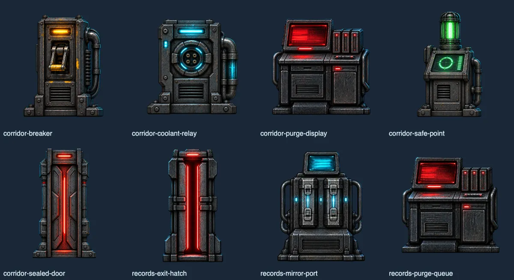

# Art batch: sprites, station props, room layers (review page, October 8, 2026)

Markdown copy of the approval sheet "WOLF//OVERRIDE Art Batch" shown to Nathanial on October 8, 2026. Scripts and styles are dropped. The props sheet is kept as WebP in [`../../sources/props-2026-10-08/approval-sheet.webp`](../../sources/props-2026-10-08/approval-sheet.webp); the other preview images were copies of art that is tracked, so the captions below point at the tracked files.

**Outcome.** Nathanial approved the regenerated sprites and the eight station props for integration on October 8, 2026 (recorded per asset in `apps/game/assets/manifest.json`: "Approved for integration by Nathanial Henniges on 2026-10-08 from a review sheet"), and the corridor and Records Access rooms were rebuilt on the parallax layers (now `apps/game/assets/rooms/`). All of this art was later superseded by the Look 2 redo (style test October 10, [`2026-10-10-style-test.md`](2026-10-10-style-test.md)).

The page uses the engineer's provisional name, Rowan. The engineer is non-binary and uses they/them.

---

*Approval sheet · October 8, 2026*

Regenerated with Codex's image tool from the current paintings and sprites as references. Everything here is still in the scratchpad: nothing has been put into the game, and the commercial rights review stays open. Each file keeps the same canvas size as the asset it would replace, so in-game scale does not change.

## Check 1. Characters: current (left) and regenerated (right)

- Rowan keeps the deep-red hooded field jacket, charcoal trousers and boots, and the cyan equipment light; no yellow patches, no silver knees. Facing right.
- WOLF keeps the grey-blue plating, cyan eye and seam lights, two ears. Facing right.
- The Director keeps the grey hair and dark coat, badge included. Facing left.
- Transparent backgrounds, no baked ground shadow (the game draws its own).

**Sprite pairs** (image not kept). Rows: Rowan, WOLF, Director. Left is in the game today; right is the regenerated version. The regenerated sprites are tracked in [`../../sources/sprites-2026-10-08/`](../../sources/sprites-2026-10-08/).

**Your call:** Use the regenerated sprites? Any one of the three can be kept as is.

## Check 2. Station props on transparency

One file per station instead of the two painted sheets, so each can sit on its own depth layer with its own glow. Colour coding is unchanged: amber breaker, blue coolant relay, red purge display and purge queue, green safe point, red sealed door and exit hatch, blue mirror port.

**Eight stations.** 512×512 each, transparent, key light from upper left with a cold rim.

**Your call:** Use these in place of the painted prop sheets?

## Check 3. Rooms as parallax layers

Far wall, mid machinery with transparency, near silhouettes at the edges. Stacked they read as one room; shifted at different rates there are no seams. These replace the single paintings so the camera can give real depth.

- **Corridor · stacked** (image not kept)
- **Corridor · parallax shift preview** (image not kept)
- **Records Access · stacked** (image not kept)

The layers themselves are in the game: `apps/game/assets/rooms/corridor-{far,mid,near}.png` and `records-{far,mid,near}.png`.

**Your call:** Go ahead and build both rooms on these layers?

---

## Credits

- Game, characters and decisions: Nathanial Henniges.
- Art: Codex's built-in image tool (edit mode), from the earlier ChatGPT Create paintings and sprites as references; provenance per asset in `apps/game/assets/manifest.json`. No C2PA manifest was present on these exports.
- Page: Claude (Claude Code) agent working for Nathanial.
