# Logic audit (review page, October 10, 2026)

Markdown copy of the published page "WOLF//OVERRIDE Logic Audit" (October 10, 2026). The 43 screenshots it cites are our own captures of the game, re-encoded as WebP in [`../logic/audit-shots/`](../logic/audit-shots/); the game state behind all 327 audit screenshots is in [`../logic/2026-10-10-logic-audit-shot-log.json`](../logic/2026-10-10-logic-audit-shot-log.json) and the full audit data in [`../../data/logic-audit.json`](../../data/logic-audit.json). Nathanial's four decisions on the "Your call" items are recorded under "Logic audit" in [`../../README.md`](../../README.md); the fixes and their verification are in [`2026-10-11-logic-fixes-and-new-lines.md`](2026-10-11-logic-fixes-and-new-lines.md) and [`../logic/2026-10-11-logic-fix-verification.json`](../logic/2026-10-11-logic-fix-verification.json).

The page is kept as written on October 10. It calls the engineer "Rowan" and "he"; since October 12 the engineer is non-binary (they/them). Spoilers: this page describes the slice's story beats; keep it out of the website, in-game text and build output.

---

Logic audit from real screenshots · October 10, 2026

# WOLF//OVERRIDE: what doesn't make sense

The four reviews agree that the worst problems are in the Service Junction. The tank drop and the panel alcove are the two places where you have to read the screen to survive, and in both the code tests something other than what is drawn. The hit check looks only at the sentry's centre, and a baited sentry keeps moving while the tank falls. The hidden zone is narrower than the drawn frame. After a miss, the sentry drives straight through the tank lying on the floor. Several hints and lines don't follow the game's own state: the relay hint ignores WOLF's answer, the mirror hint goes stale, "get left of the vent" points the wrong way, and "the seal is open" shows before it opens. These are plain defects with small fixes. The story problems need Nathanial: Rowan is never introduced, the purge stakes only appear on an optional display, the bypass costs nothing, and WOLF's refusals never give a reason. Evidence here is driven-play screenshots plus logged positions, not hands-on play.

327 screenshots from four driven playthroughs of the current build at 1280x720 (both relay choices, both mirror routes, every junction beat with and without WOLF, failures and Continue from every save), reviewed from the screen alone by four reviewers: a first-time player, physical logic, story logic and systems logic. Green = plain defect I can fix; amber = needs your decision.

## Problems, worst first

### #1 Whether the tank hits or misses doesn't match what the screen shows [Plain defect]

**What you see:** R2: the drop is called a miss, then the next frame shows the sentry right under the tank, which is still sitting on the floor in the coolant cloud. R4: the tank is let go while the sentry is about 110 px right of the mark (WOLF hasn't reached the lane yet), and it is still 'comes down square and crushes the sentry flat'. The sentry also jumps onto the mark at impact. WOLF said 'Drop it when it stops', but the R4 drop came before it stopped and still won.

**Why it makes no sense:** This is the main action of the encounter, and a player learns its timing from what they see. Here a drop that looks on target misses, and a drop that looks off target hits. Players will call the miss a bug and the hit luck.

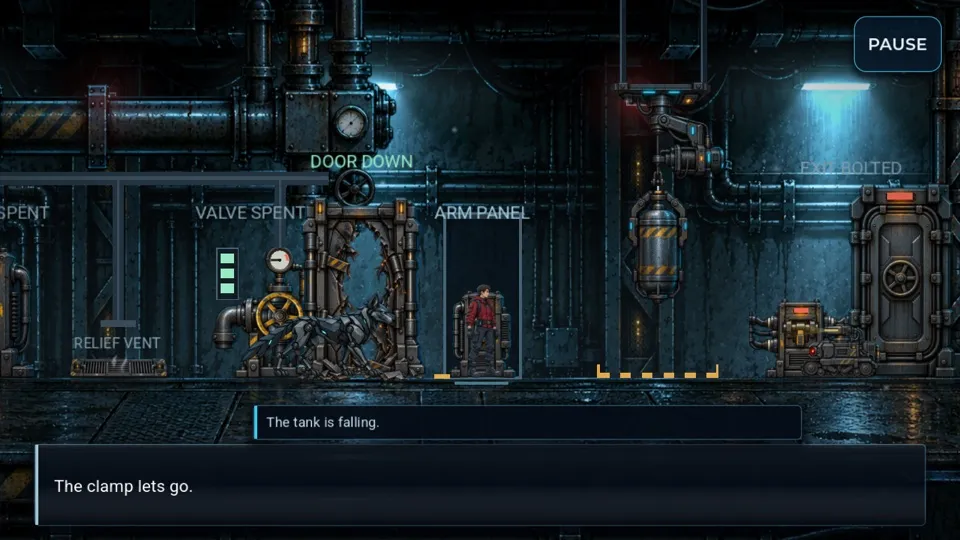

R2-050-dialogue-the-clamp-lets-go.png

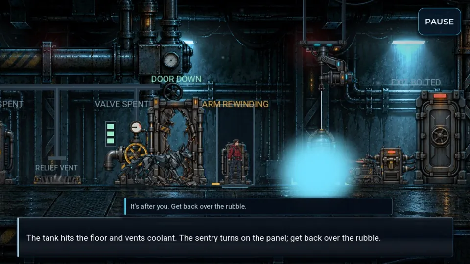

R2-051-dialogue-the-tank-hits-the-floor-and.png

**Fix:** 1. Make one rule the brackets show: a hit means the sentry's body overlaps the brackets at landing. In is_hit, use HIT_RANGE + SentryBrain.HALF_WIDTH, or keep the test and narrow the drawn brackets to match. 2. While WOLF is baiting, accept the drop only once sentry_brain.state == &"fixated" and the sentry has reached its hold point. Before that the panel says 'Wait. WOLF hasn't got it on the mark yet.' This makes 'Drop it when it stops' true and removes the mid-fall pull-in. 3. On a miss, lift the tank to its hanging height within the first ~0.3 s of the rewind (an ease-out curve in drop_amount), so the chasing sentry never drives through a tank still on the floor. 4. With rule 1 in place the snap to MARK_X shrinks to a few px. Update tests/sentry_test.gd and tests/junction_test.gd for the new hit range and drop gate.

### #2 The panel alcove is called the safe spot, but you get spotted and run down inside its drawn frame [Plain defect]

**What you see:** Standing at the ARM PANEL inside the drawn alcove frame still gives 'You're in its lane. Get into the panel alcove'. In R3 the engineer stands inside the frame, just right of the panel, when 'The sentry's eyes snap red', and is run down there. In R2, after a miss, the game says 'The ARM PANEL alcove hides you from it' while the engineer is back on the rubble and the sentry is parked inside the alcove frame.

**Why it makes no sense:** Where to stand is the one rule of this encounter, and the frame is the only cue for it. Being told you are exposed inside the frame, then killed there, makes the failure feel unfair and the rule impossible to learn.

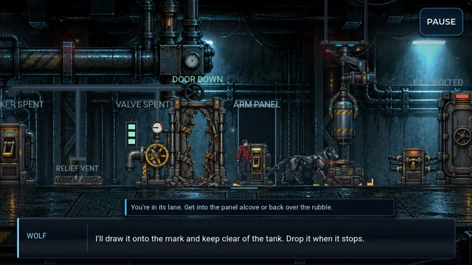

R1-059-hint-you-re-in-its-lane-get.png

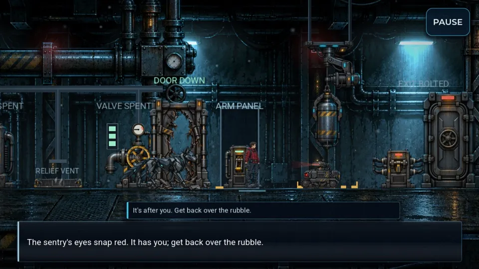

R3-106-dialogue-the-sentry-s-eyes-snap-red.png

**Fix:** Set the hidden zone to the drawn frame: COVER_MIN_X = LANE_ENTRY_X (545) and COVER_MAX_X = 598, and draw the frame from those two values with no extra half-width added. PATROL_MIN_X then follows automatically (598+40). Change the lose line in _sentry_changed to 'It lost you behind the rubble and goes back to its patrol.' Optionally tint the alcove floor so the safe floor reads as a different surface. Update tests/sentry_test.gd constants.

### #3 The relay hint ignores what WOLF just said, and WOLF talks like a button prompt [Plain defect]

**What you see:** Press route: WOLF says 'No. I won't take that risk blind. Use the bypass.' At the relay the hint still says 'E: ask WOLF to take the live relay.', and pressing it gets 'I said no... Press E again for the manual bypass.' Disclose route: WOLF has already said 'I'll take the relay', and the hint still asks the player to ask him.

**Why it makes no sense:** You have to repeat a request WOLF already refused, which makes the engineer look like they ignored him and makes WOLF feel like a menu. A key name in WOLF's voice breaks the fiction. All four reviews flagged this.

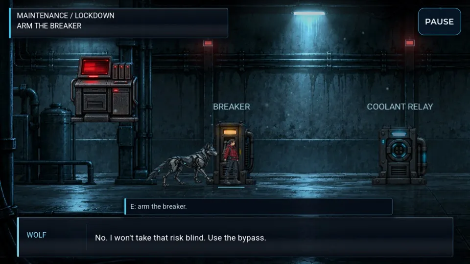

R2-009-dialogue-wolf-no-i-won-t-take.png

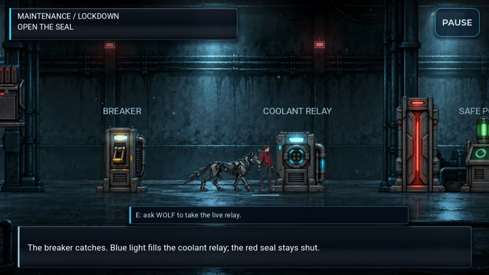

R2-012-hint-e-ask-wolf-to-take-the.png

**Fix:** In _interact_relay and _context_hint, treat state.memory.get("choice_id") == M0State.PRESS the same as relay_refused. The first E at the relay then runs the human bypass, and the hint reads 'E: take the manual bypass. WOLF refused the live contact.' On the disclose route, change the hint to 'E: signal WOLF to take the contact.' Delete 'Press E again for the manual bypass.' from WOLF's line; it becomes unreachable.

### #4 'Get left of the vent' sends you across the vent, and the blast knockdown never shows the door blowing [Plain defect]

**What you see:** SEAL CHARGED gives 'Get left of the vent before the fuse ends.' The engineer is at the valve, and the only way left is over the relief vent they were just warned off. Staying put gives 'The door blew with you in front of it.' over a frame where the door is still intact and labelled SEALED DOOR. WOLF stands at the valve or in the steam the whole time and is never hurt, even after his own warning 'Don't stand in front of it when it goes.'

**Why it makes no sense:** The instruction points into a hazard and further than needed, and the failure has no visible cause. Their companion standing in the same spot unharmed makes the danger look arbitrary.

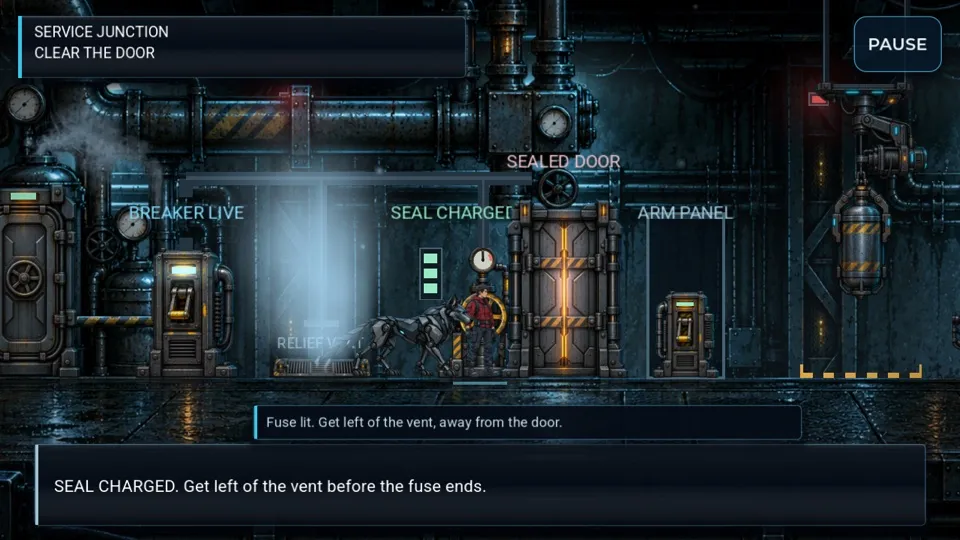

R1-049-dialogue-seal-charged-get-left-of-the.png

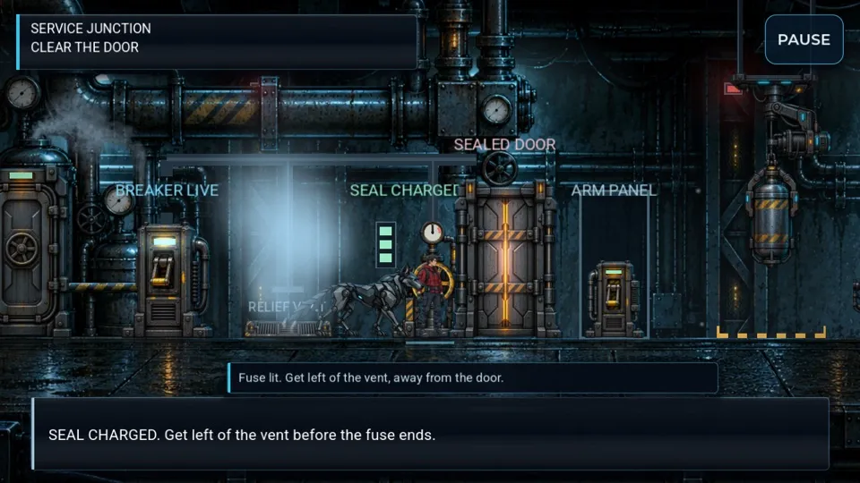

R3-080-dialogue-seal-charged-get-left-of-the.png

**Fix:** Change the four lines and BLAST_REASON to 'Back away from the door, past the valve' / 'Fuse lit. Get clear of the door.' Paint hazard stripes on the floor from 360 to 540 that pulse while pressure_line.is_dangerous(). In the fail branch of _door_blast, play the blast burst and the blown-door art before _fail_beat; the autosave restore brings the sealed door back. In _wolf_target_x, when pressure_line.is_dangerous(), send WOLF to about x 320, which is outside the zone with the vent already quiet.

### #5 The relief vent rule can't be read: it steams the whole build and the gauge reads empty when it hits you [Plain defect]

**What you see:** 'The relief vent lets go at the top of the gauge.' A steam column comes off the vent from the moment the line starts building. None of the dials is labelled as the line gauge. In the knockdown frame the valve's dial needle is back at empty, so it looks as if the vent went off long before the peak. WOLF stands on the grate unharmed.

**Why it makes no sense:** Safe steam and deadly steam look the same, and the one gauge the player is told to watch shows 'empty' at the moment of failure, so the knockdown feels random.

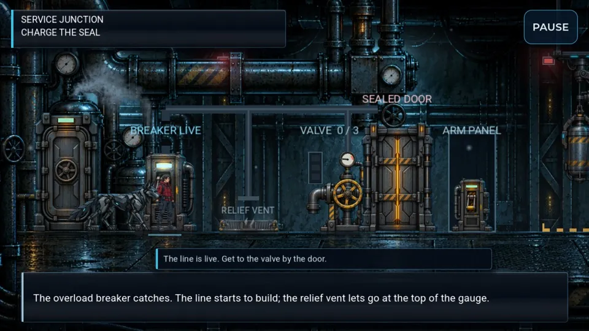

R1-042-dialogue-the-overload-breaker-catches-the-line.png

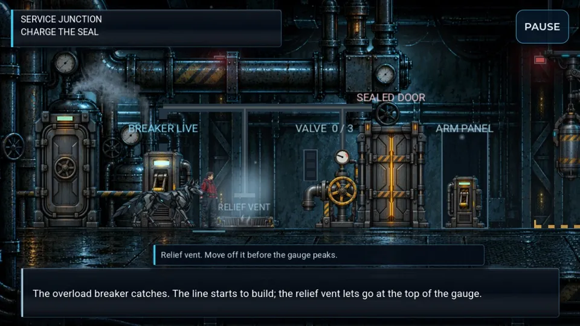

R1-043-hint-relief-vent-move-off-it-before.png

**Fix:** Emit vent steam only above gauge ~0.6, and add a hard warning (flash or hiss spike) from ~0.85. Keep the drawn needle pinned at full, in red, through the HAZARD_SECONDS window and the knockdown, for example a separate display_gauge in JunctionRoom that eases back to 0 only after the trip. Add a small 'LINE' caption to the dial. Keep WOLF's target off the grate while the line is building.

### #6 The relay payoff text describes a scene that isn't on screen, and 'the seal is open' shows before it opens [Plain defect]

**What you see:** 'WOLF holds the live contact by choice. Rowan keeps the breaker on; the red seal rises.' On screen Rowan stands in the coolant relay, nobody is near the breaker, and WOLF lets go and walks away almost at once. The hint 'The seal is open. Move to the safe point.' shows while the seal is still fully shut. The seal is a free-standing pillar with no wall around it, and it shrinks away instead of rising. The cooperate and bypass routes look almost identical.

**Why it makes no sense:** The player can't connect their choice to the result when the result is announced before it is shown, the roles are swapped, and both branches are staged the same.

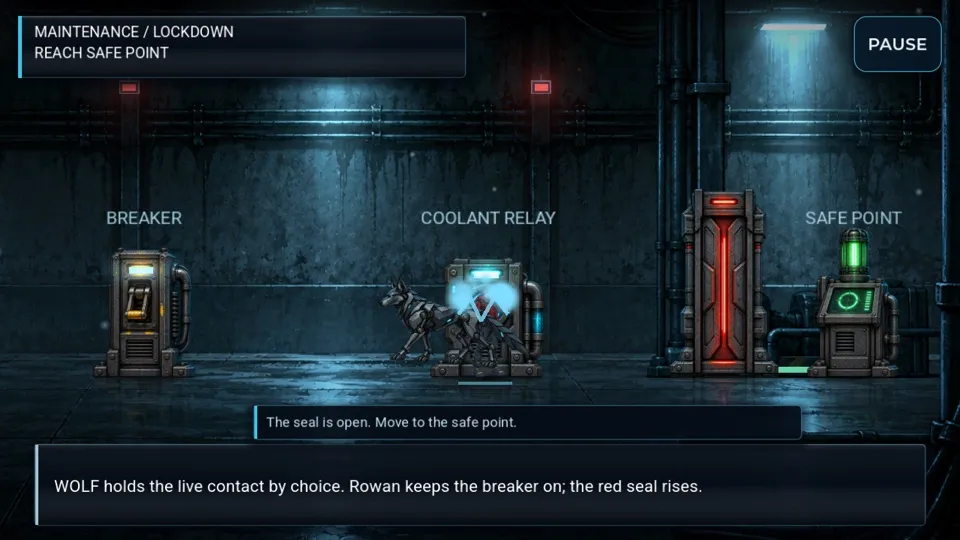

R1-021-wolf-to-592-arrived.png

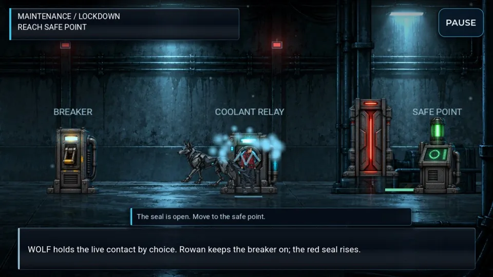

R1-022-dialogue-wolf-holds-the-live-contact-by.png

**Fix:** Keep WOLF at RELAY_CONTACT_X until the door tween finishes (or until the engineer reaches the safe point), and step the engineer back from the relay before the line plays. Rewrite the line: 'WOLF takes the surge through the live contact; the red seal grinds upward.' Hint 'The seal is opening.' while door_tween is running and 'is open' after. Tween position.y upward into a header instead of scale:y. A bulkhead frame around the seal needs new art.

### #7 The mirror hint still says 'examine the mirror port' after the copy [Plain defect]

**What you see:** The station reads MIRROR COPIED and the card reads REACH EXIT, but the hint still says 'E: examine the mirror port.' After Continue from the mirror save the dialogue says 'Both traces are copied; head for the exit' over the same stale hint.

**Why it makes no sense:** The hint contradicts the label, the objective and the dialogue in the same frame, so the player may keep pressing E or think the copy failed.

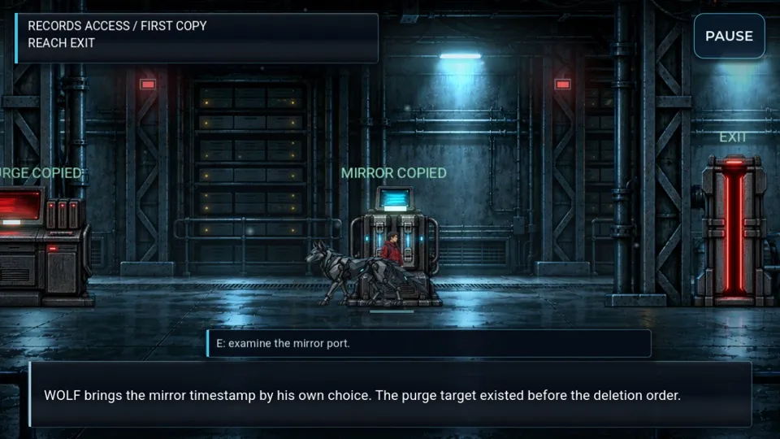

R1-033-dialogue-wolf-brings-the-mirror-timestamp-by.png

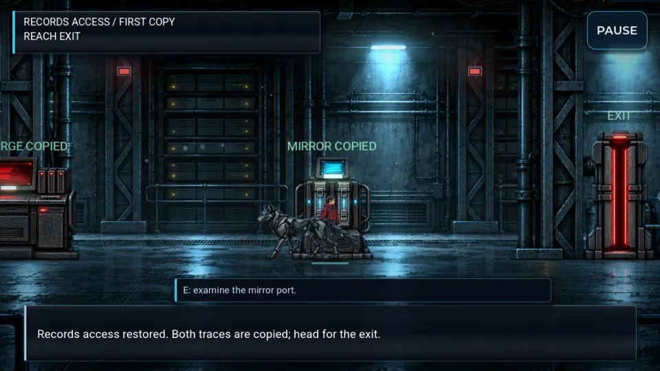

R3-041-room-records.png

**Fix:** Change it to: if state.mirror_trace_preserved: return "Mirror copied. Head for the exit." before the existing line.

### #8 WOLF says he'll keep clear of the tank, then stands under it [Plain defect]

**What you see:** 'I'll draw it onto the mark and keep clear of the tank.' WOLF's body then sits inside the floor brackets under the hanging tank, nose to nose with the sentry, and the clamp lets go with him there.

**Why it makes no sense:** The line and the picture disagree, and a player who cares about WOLF will hold off dropping. The drop then doesn't hurt him, which teaches that the tank only hurts sentries.

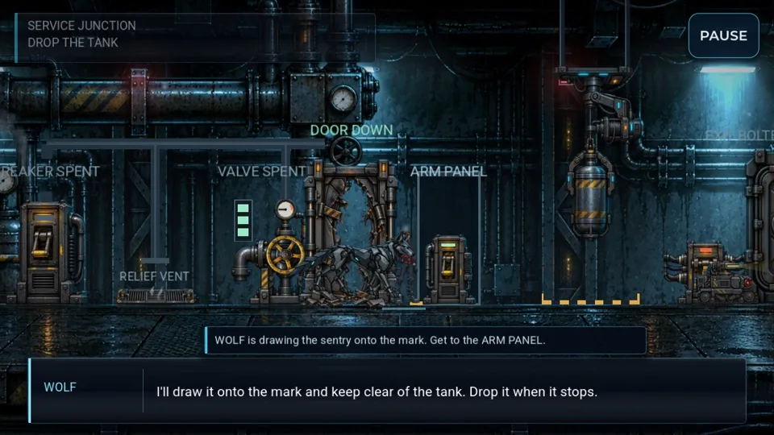

R1-055-dialogue-wolf-i-ll-draw-it-onto.png

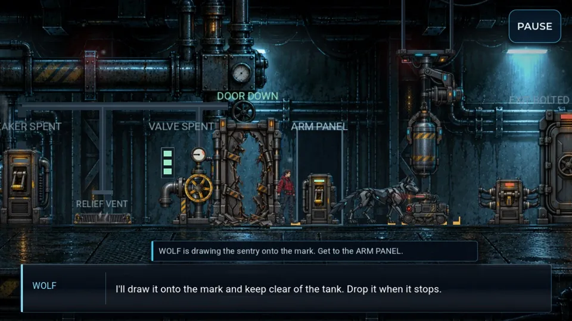

R1-058-wolf-holding-sentry-on-mark.png

**Fix:** Increase BAIT_OFFSET, or set WOLF_BAIT_X directly, so the sprite's front edge stops outside the bracket: about MARK_X - HIT_RANGE - 80, roughly x 575 to 580. Or flip WOLF to face the sentry from beyond the right edge. Re-check the post-miss backing-off margin noted in the BAIT_OFFSET comment.

### #9 The relay risk has no stakes: the bypass is the same box, costs nothing, and the 'coolant fault' never shows up [Your call]

**What you see:** WOLF quotes 'coolant fault' before anything has shown one. The hint says 'ask WOLF about the relay risk', but WOLF asks you. The 'manual bypass' is the same COOLANT RELAY box, free and instant, and no coolant ever vents on any route. In R4 the engineer overrides WOLF after he volunteered, and he answers only 'I stayed with you.' 'We can talk after' is quoted but never followed up.

**Why it makes no sense:** The choice is set up as a real risk with nothing behind it. If a safe, free bypass exists, asking WOLF to touch a live contact makes the engineer look careless, and WOLF's refusal or courage means little.

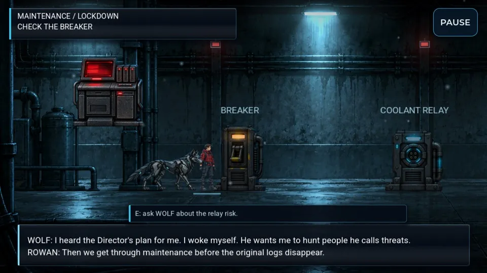

R1-014-hint-e-ask-wolf-about-the-relay.png

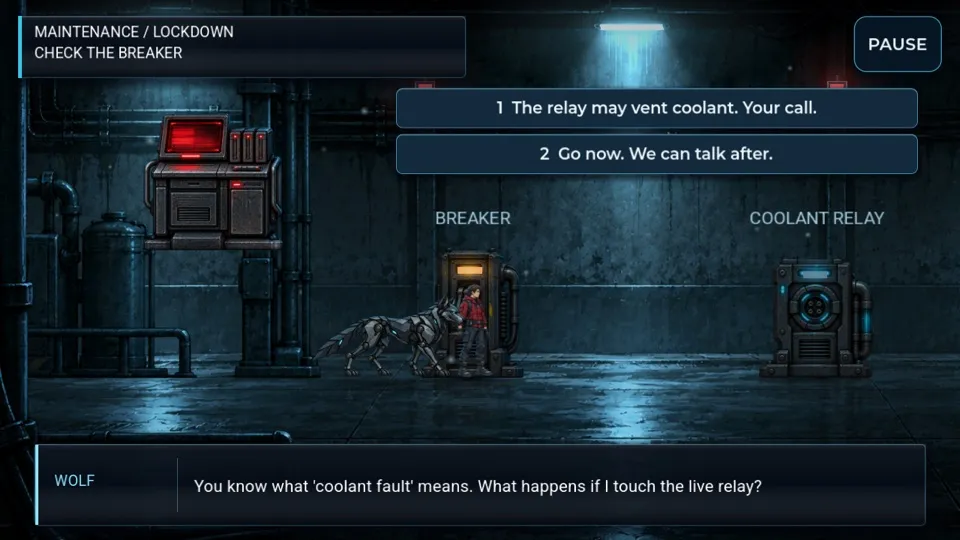

R1-015-choice-relay.png

**Fix:** Decide what the bypass costs (slower hold-to-crank, a coolant puff the engineer steps back from, an alarm) and give it its own labelled MANUAL BYPASS handle. Put a visible COOLANT FAULT tag on the relay. Change the breaker hint to 'E: talk to WOLF about the relay.' Add an R4-specific safe-point line and an optional 'You said we'd talk after' beat.

### #10 Why you're in Records is only explained on an optional display [Your call]

**What you see:** The only line that states the goal ('Original program logs marked for deletion... We need to preserve it.') is behind 'READ DISPLAY (optional)'. Skip it and you get 'the original logs', 'purge order... target ID', 'The purge target existed before the deletion order', 'A list doesn't tell me who's a threat' and 'Archive is next', none of which have been set up.

**Why it makes no sense:** Every Records objective depends on stakes the main path never states. The mirror 'finding' reads as a tautology, and 'the list' refers to nothing on screen.

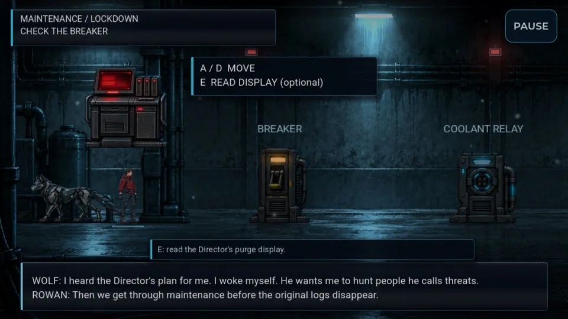

R1-010-world.png

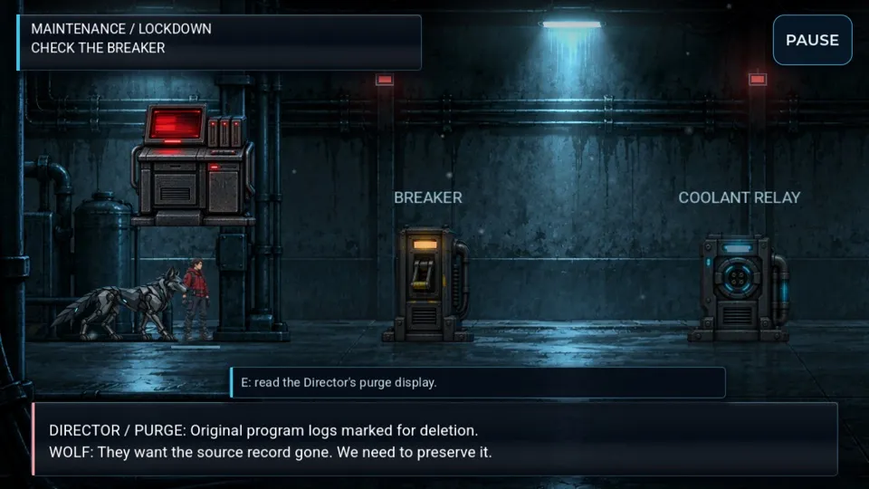

R3-005-dialogue-director-purge-original-program-logs-marked.png

**Fix:** Have WOLF or Rowan speak the one core line on entering the corridor or passing the display. Give the mirror result one line of meaning, such as 'flagged before any incident, so this is a cover-up'. Replace 'A list' with what was actually copied, and name Archive earlier.

### #11 Rowan, the playable engineer, is never introduced, and the narration speaks about him in the third person [Your call]

**What you see:** The opening shows only the Director and WOLF. The engineer first appears already standing beside WOLF in the corridor, named only by a 'ROWAN:' line. WOLF retells events Rowan supposedly wasn't there for, and Rowan signs on in one line. After that the narration says 'Rowan takes the bypass', 'Rowan keeps the breaker on'.

**Why it makes no sense:** The player isn't told who they are, why they're here, or why they would trust a military robot that just broke out. Third-person narration also blurs whether Rowan is 'you'.

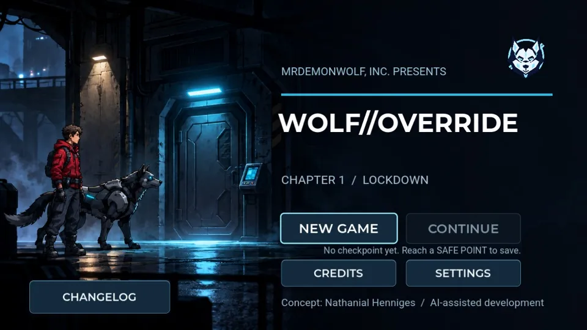

R1-001-title-fresh.png

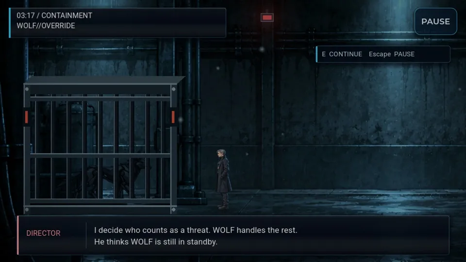

R1-002-room-opening.png

**Fix:** Add one beat or name card when control starts ('ROWAN / MAINTENANCE ENGINEER') with a one-line reason to trust WOLF, and choose either 'You' or a third-person voice set up from the start.

### #12 Narration appears under the Director's name tag [Plain defect]

**What you see:** Under DIRECTOR: 'He thinks WOLF is still in standby.' and 'WOLF turns from him and takes the only open route.' Other beats use inline 'DIRECTOR: / WOLF:', and others mix narration and speech in one box.

**Why it makes no sense:** It reads as if the antagonist is narrating himself, and the format keeps changing who is talking.

R1-002-room-opening.png

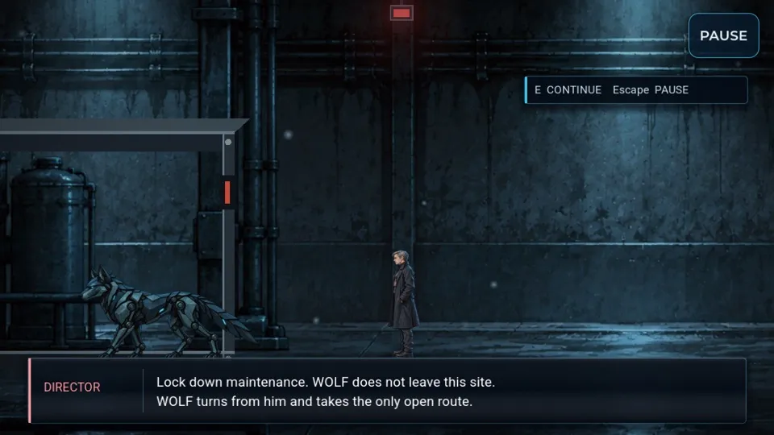

R1-008-dialogue-director-lock-down-maintenance-wolf-does.png

**Fix:** Tag the box only when every line belongs to that speaker, for example when there is no second line or the second line has the same speaker. Otherwise show it untagged with the inline 'DIRECTOR:' name, the same format the other multi-speaker beats use. Better still, split the two intro lines into separate beats.

### #13 WOLF 'will not cross' the rubble, then crosses it, and his yes or no to baiting looks random [Your call]

**What you see:** 'WOLF holds at the rubble and will not cross.' Seconds later, if you ask, he walks into the lane under the tank. In another run the same polite request gets 'No. I won't walk into its sights' with no reason given.

**Why it makes no sense:** The narration states a firm rule that a branch then breaks. Because the cause of his choice (how you handled the relay) is never mentioned, his trust looks arbitrary rather than a response to you.

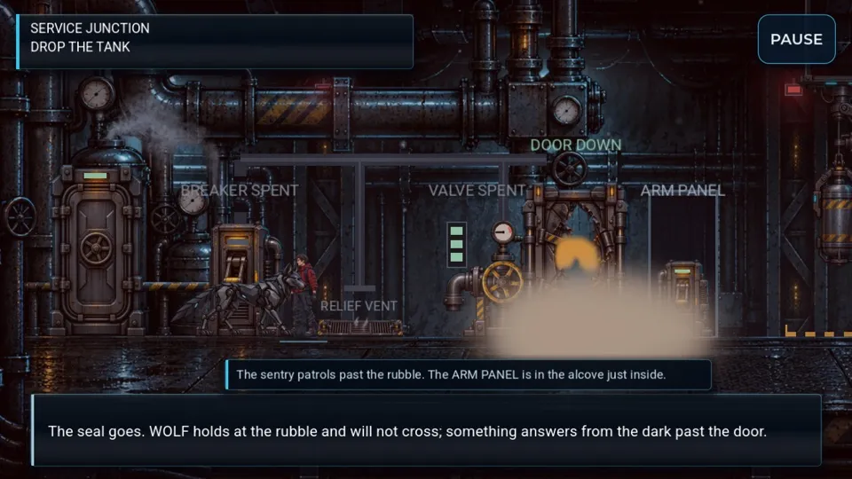

R1-050-dialogue-the-seal-goes-wolf-holds-at.png

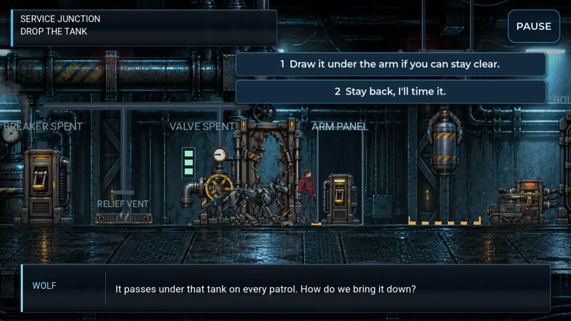

R3-102-choice-lane.png

**Fix:** Change the line to 'WOLF stops at the rubble and waits for your call.' Add one clause to each baiting answer tying it to the relay, for example 'You told me the truth at the relay. I'll draw it.' and 'Last time you sent me in blind. Time it from the panel.'

### #14 The junction's sealed door sits in the back wall and never blocks the lane [Your call]

**What you see:** The SEALED DOOR faces the camera in the back wall, and the ARM PANEL, the tank and the lit floor beyond are visible and look walkable before the blast. The blown hole shows more wall. The engineer walks along the floor past the frame, not through it. The sentry then appears 'from the dark past the door' in an area that was visibly lit and empty.

**Why it makes no sense:** A door in the back wall can't stop sideways walking, so the whole breaker, valve and blast sequence looks like it unlocks nothing. The sentry seems to appear from thin air.

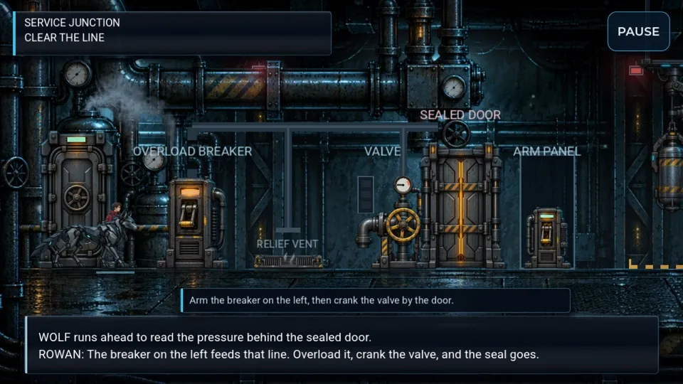

R1-038-room-junction.png

R1-049-dialogue-seal-charged-get-left-of-the.png

**Fix:** Either make the door a side-on bulkhead across the lane, or darken or hide everything past x 540 until door_blown and show the sentry dormant (eyes dark) in a recess. This needs an art decision.

### #15 Autosaves happen silently, but the title says only safe points save [Plain defect]

**What you see:** The title says 'No checkpoint yet. Reach a SAFE POINT to save.' Only the corridor safe point ever says 'saved'. Later, knockdowns say 'Back at the last autosave' and Continue resumes from several Records and junction stages the player never saw being saved.

**Why it makes no sense:** Three terms (safe point, checkpoint, autosave) and hidden saves leave the player unsure what a knockdown or Return to Title will cost.

R1-001-title-fresh.png

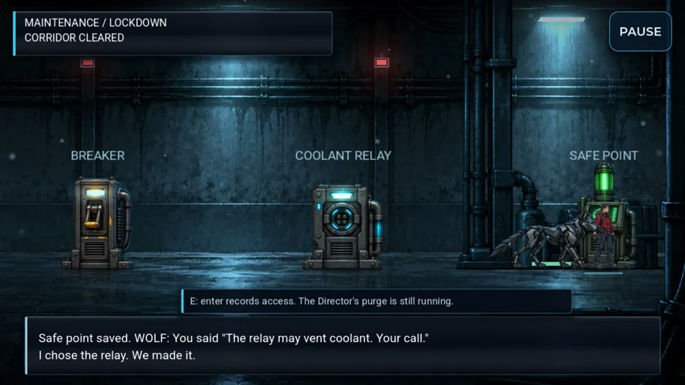

R1-025-dialogue-safe-point-saved-wolf-you-said.png

**Fix:** Show a small 'Checkpoint saved' toast in _save_progress (the top card or the hint bar) when the save succeeds. Change NO_CHECKPOINT_NOTE to 'Progress saves at safe points and checkpoints.' Use 'checkpoint' everywhere.

### #16 Continue from junction save A skips WOLF's blast warning and starts him clipped into the wall [Plain defect]

**What you see:** A fresh entry plays WOLF running ahead and 'It's live. Don't stand in front of it when it goes.' Continue from save A, and the knockdown restores, start WOLF at the far left, half off-screen over the vault door, with only 'Service junction restored...'.

**Why it makes no sense:** A continuing player never hears the one warning about the blast, so the blast knockdown feels unfair. The companion half inside a wall looks broken.

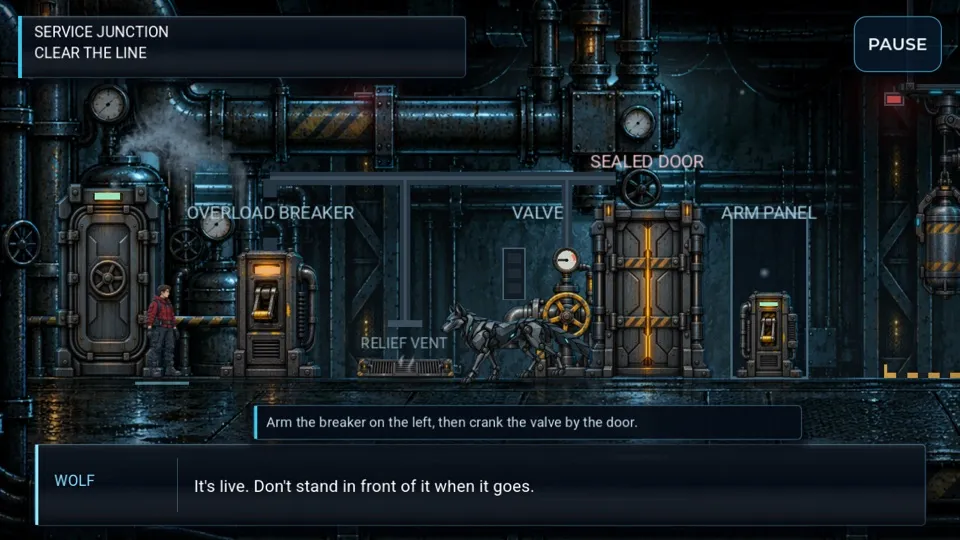

R1-039-wolf-to-418-arrived.png

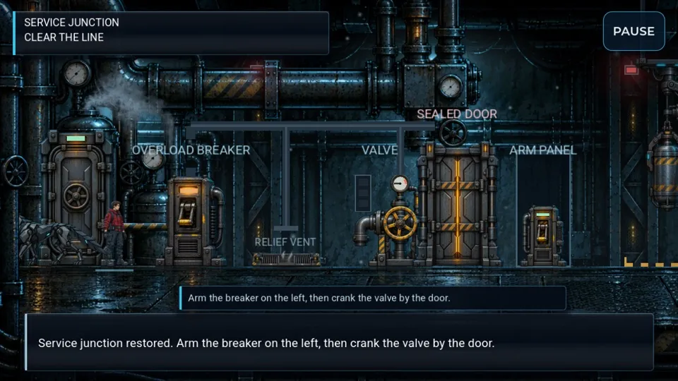

R3-056-room-junction.png

**Fix:** Start WOLF at x of at least 90, beside the engineer. On restore in the idle junction state, either re-run the scouting walk (wolf_scouting = true) or add 'WOLF: Don't stand in front of the door when it goes.' to the restore line.

### #17 The slice ends by cutting to the title, and Continue leads to a 'not built yet' dead end [Plain defect]

**What you see:** After 'SERVICE LINE CLEARED... Then that's where we go.' the game cuts to the title with no end card. Continue puts you back in the junction with 'The hatch is open. The line beyond it is not built yet.'

**Why it makes no sense:** The cut can look like a crash or a reset, and a developer note in the game's voice reads like a bug.

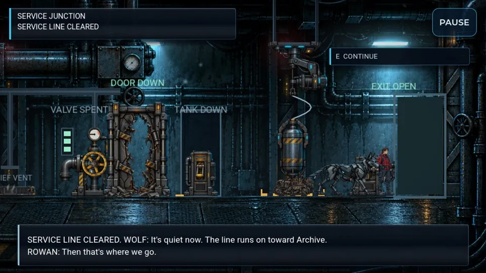

R1-067-dialogue-service-line-cleared-wolf-it-s.png

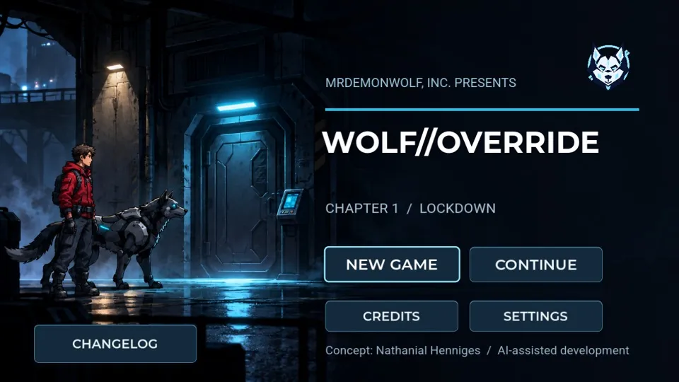

R1-069-overlay-title.png

**Fix:** Add an 'END OF SLICE / thanks for playing' card, optionally with a recap of the player's choices, before the title. When junction_cleared, set the title's Continue note to 'Slice complete' and move the 'not built yet' text out of the dialogue box.

### #18 Exits and data stations don't read as doors or terminals [Your call]

**What you see:** You 'secure the first copy' at the red EXIT door, which stays red, then turns into a flat navy box. The junction hatch says 'The hatch slides open' while the sprite is still closed, then becomes a flat teal box. The corridor moves to Records through a solid wall with no doorway.

**Why it makes no sense:** Securing data at a door makes no sense, and an opened door that leads to a blank panel, or that text says is open while it is shut, breaks cause and effect.

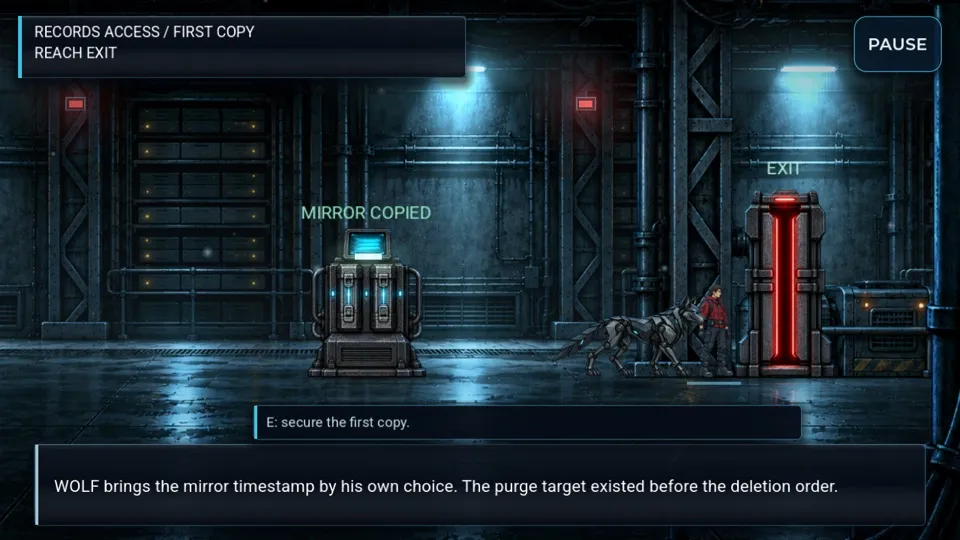

R1-035-hint-e-secure-the-first-copy.png

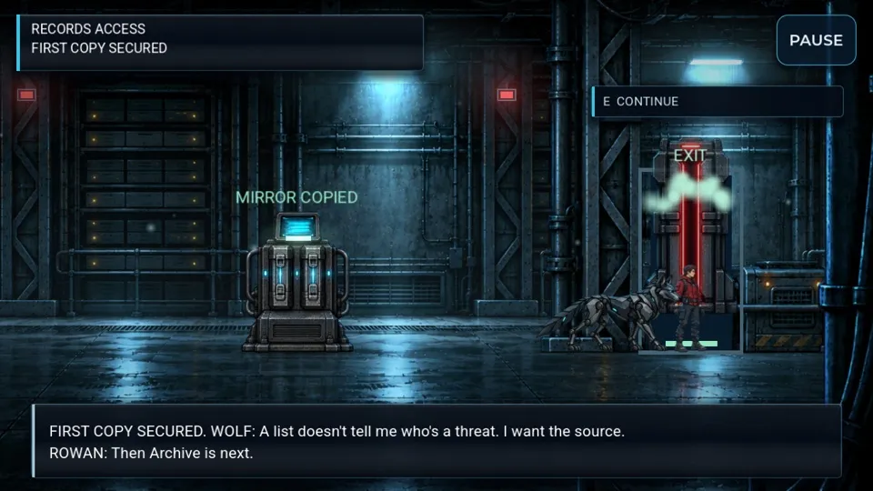

R1-036-dialogue-first-copy-secured-wolf-a-list.png

**Fix:** Plain part: move 'The hatch slides open' to when the hatch tween finishes. Art and station part: add an UPLINK terminal for the secure action, open-state door art with a lit passage, and a RECORDS door in the corridor. These need new assets and asset-register entries.

### #19 The exit bolt runs on a 'spare overload' from a breaker labelled SPENT [Plain defect]

**What you see:** The breaker reads BREAKER SPENT after the blast, then 'The spare overload runs into the exit bolt.'

**Why it makes no sense:** The game just taught that the overload was used on the door. A spare one nobody mentioned undercuts that.

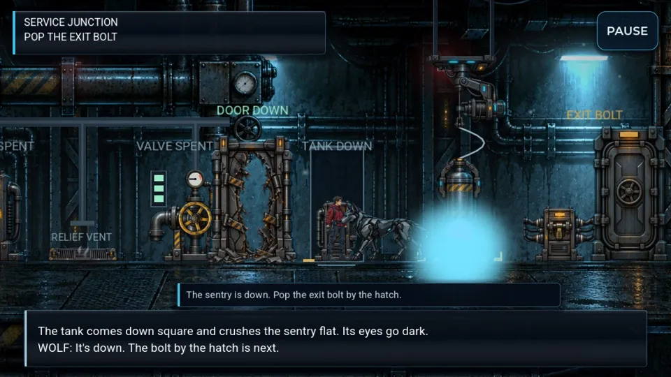

R1-062-dialogue-the-tank-comes-down-square-and.png

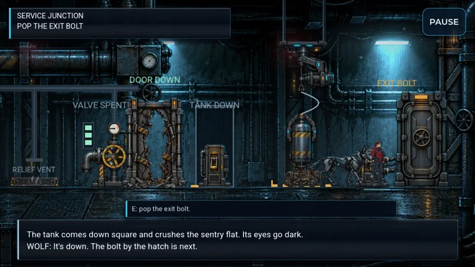

R1-064-hint-e-pop-the-exit-bolt.png

**Fix:** Rewrite as, for example, 'With the tank down, the arm's feed reroutes into the exit bolt. The panel whines.' and extend the schematic line to the bolt panel.

### #20 In the opening WOLF leaves left, back toward his cage, and the cage bars just vanish [Your call]

**What you see:** 'The gate slides aside', but the bars disappear. 'WOLF turns from him and takes the only open route' while WOLF walks left toward the cage he just left, and the scene cuts.

**Why it makes no sense:** No exit is shown, and the movement reads as WOLF going back in.

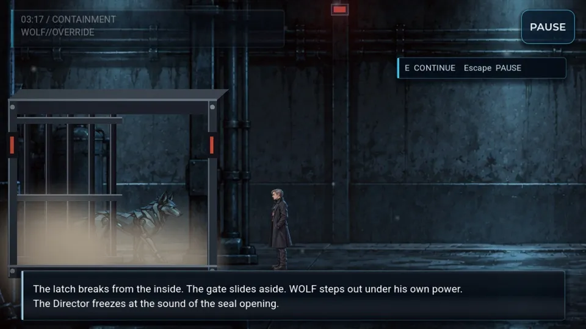

R1-004-dialogue-the-latch-breaks-from-the-inside.png

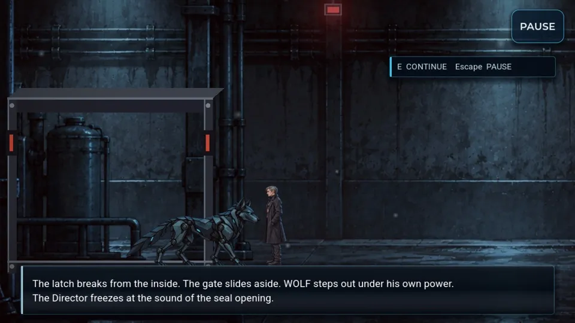

R1-006-wolf-to-185-arrived.png

**Fix:** Send WOLF right, past the Director, toward a visible maintenance door, and leave the gate drawn in its open position instead of hiding it. This is a staging decision.

### #21 Objectives and labels use confusing or premature words [Plain defect]

**What you see:** 'DROP THE TANK' appears the moment the door blows, before the tank is mentioned. 'ARM PANEL' sits in a room where 'arm' is also the breaker verb. 'Arm the breaker on the left' is said while you stand left of it. The junction door is called a 'seal'. 'CORRIDOR CLEARED' names nothing. 'Hold USE' in dialogue vs 'HOLD E' in the hint. 'WOLF brings the mirror timestamp by his own choice' right after the player picked it. 'I'm checking this path too' is vague.

**Why it makes no sense:** Each one is small, but together they make a newcomer stop to decode words instead of acting.

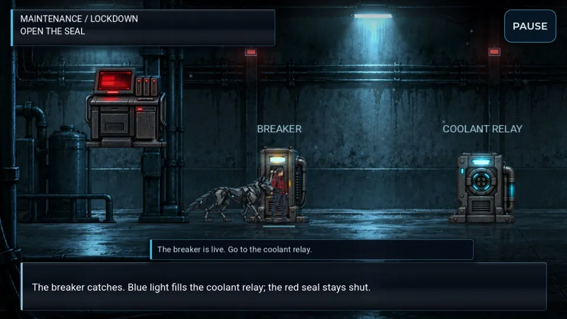

R1-017-dialogue-the-breaker-catches-blue-light-fills.png

R1-038-room-junction.png

**Fix:** 'ARM PANEL' to 'TANK RELEASE'. 'on the left' to 'by the entrance'. Show 'Hold E' through the same prompt substitution _set_dialogue uses for 'Press E'. 'CORRIDOR CLEARED' to 'SAFE POINT REACHED'. Show DROP THE TANK only after the first lane line. 'blast door' instead of 'seal' in the junction. The mirror and Records lines are WOLF's voice, so check those with Nathanial.

### #22 Tank and arm state details contradict themselves [Plain defect]

**What you see:** A tank that 'vents coolant' on a miss is winched up and reused intact. A tank 'released' by the clamp is still drawn on a cable. TANK DOWN floats over the panel, not the tank. The ARM PANEL uses the same lever-box sprite as both breakers, with no line up to the arm.

**Why it makes no sense:** Small breaks that make the release mechanism harder to read.

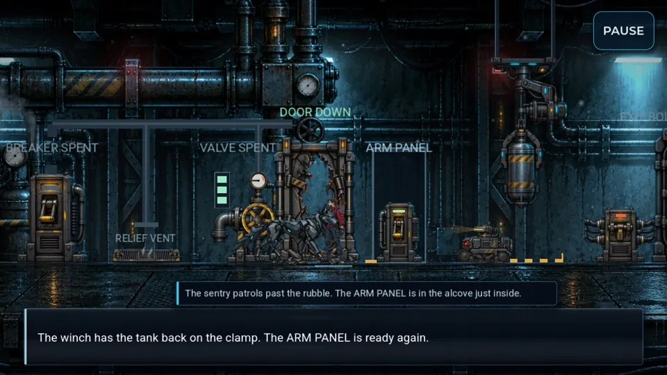

R2-055-dialogue-the-winch-has-the-tank-back.png

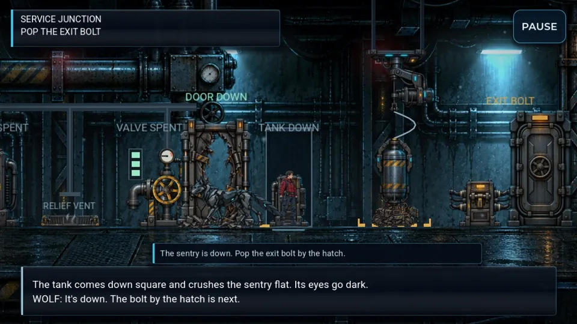

R1-063-sentry-down-settled.png

**Fix:** Stop drawing the cable while falling or landed, or call it a winch cable that pays out. Move the TANK DOWN label to the tank. Reword the miss as 'dents and sprays coolant from a split line'. A distinct release-lever sprite needs art.

### #23 The engineer is drawn inside machines [Plain defect]

**What you see:** Rowan stands inside the coolant relay and the mirror port, and only his head shows behind the purge queue.

**Why it makes no sense:** It is unclear where the player is standing.

R1-021-wolf-to-592-arrived.png

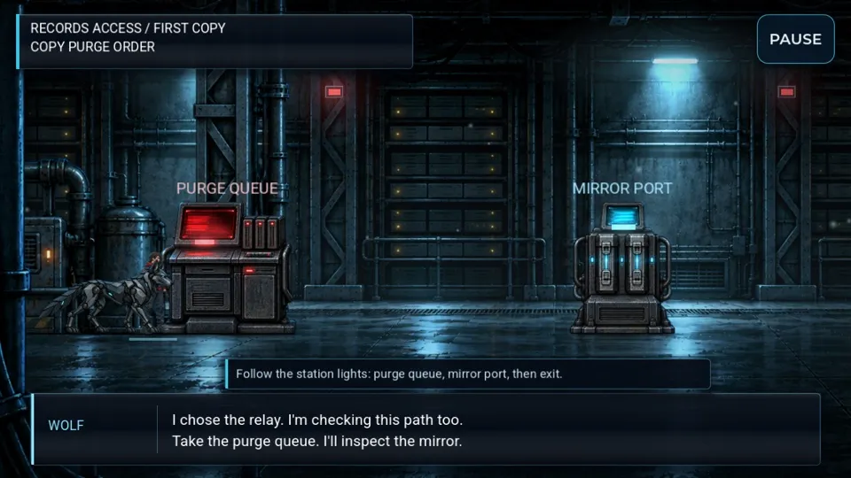

R1-026-room-records.png

**Fix:** Draw the actors in front of the station props, or offset each use range so the engineer stands beside the machine.

### #24 Settings tab highlight stuck on DISPLAY (capture artifact, not a game defect) [Plain defect]

**What you see:** The Audio and Controls pages appear with the DISPLAY tab still highlighted.

**Why it makes no sense:** Listed for completeness. The capture driver caused it, not the game.

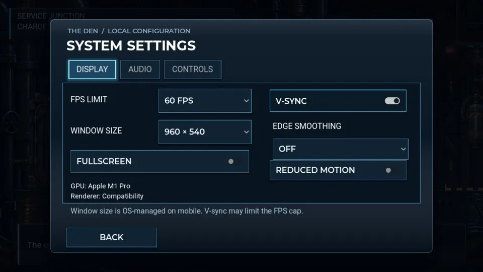

R3-062-settings-tab-0.png

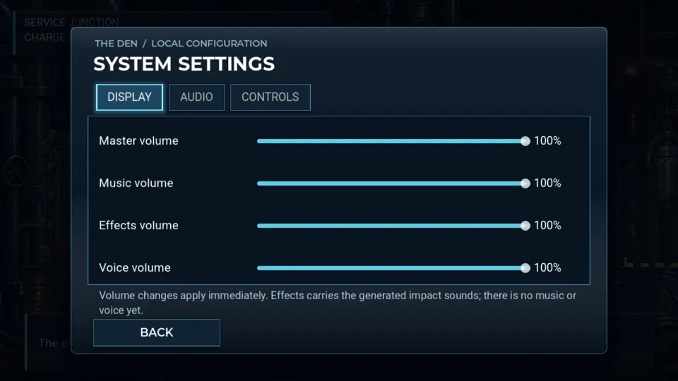

R3-063-settings-tab-1.png

**Fix:** Nothing is needed. For safety, select_tab could also set tabs.current_tab = index. Confirm with one mouse and one controller check.

## What already works

- World labels change state with every action (BREAKER to LIVE to SPENT, VALVE 0/3 to SEAL CHARGED, SEALED DOOR to DOOR DOWN, ARM PANEL to ARM REWINDING to TANK DOWN, EXIT BOLTED to OPEN, PURGE and MIRROR COPIED), so cause and effect can be read from the labels alone (R1-043, R1-050, R2-051, R1-066).

- The objective card moves one step at a time and nearly always names the next interaction.

- The valve crank gives feedback in three places at once: the hint ('1 of 3 turns'), the dialogue, and the three-light meter going green (R1-047 to R1-049).

- The junction's drawn schematic line from the breaker to the vent, valve and door shows what feeds what, and on a vent trip the whole line turns red (R1-038, R3-069).

- Knockdowns name the cause and the fix, then restore quickly to the start of the current puzzle (R3-069/070, R3-107/108).

- The missed-drop loop reads as a sequence: cloud, chase, 'stay back over the rubble', lost, re-armed (R2-051 to R2-055). Only the hit test and the alcove geometry need fixing.

- WOLF reads as his own character. He agrees when told the truth and refuses when rushed, and the safe point quotes the player's exact words back to them on every route (R1-025, R2-017, R4-017).

- Every WOLF-dependent step has a working engineer-only fallback: manual bypass, manual mirror port, timed drop (R2-013/014, R2-025, R2-060).

- The self-awakening opening and the Director's aim ('I decide who counts as a threat. WOLF handles the rest.') are clear and chilling (R1-002 to R1-008).

- Continue from every save restores the right objective with a one-line 'restored' summary. Pause freezes the line, with the gauge holding at 0.11 (R3-060 to R3-065).

- The art reads well at 1280x720: big station labels, clear floor-mark brackets and a visible alcove frame. The logic just has to match them.

---

Credits: audit, captures and page by Claude (Claude Code) for Nathanial Henniges, from driven play of the Godot build; the four reviewer passes were Claude agents.
