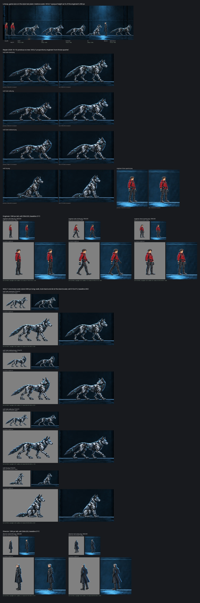
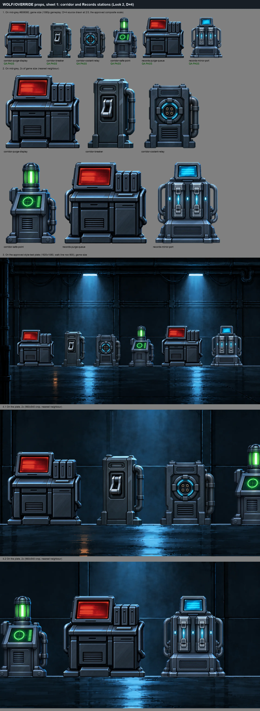
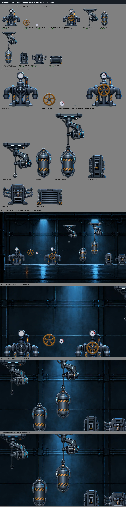
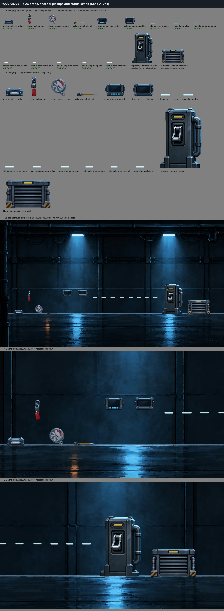
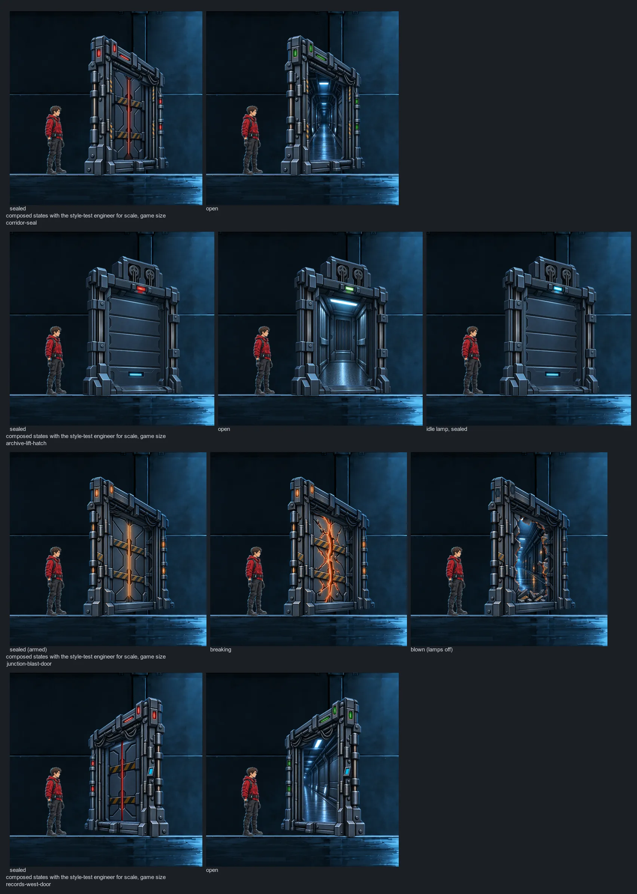
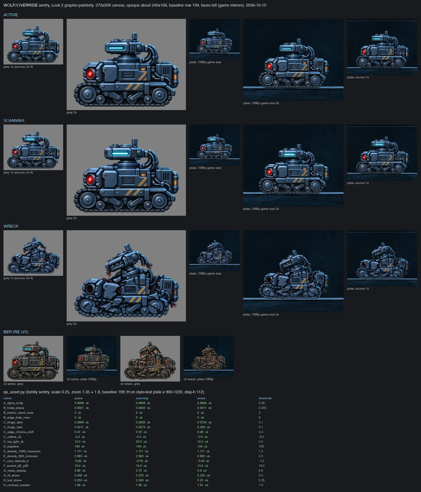

# Assets in Look 2 (review page, October 10, 2026)

Markdown copy of the page "WOLF//OVERRIDE Look 2 Assets" shown to Nathanial on October 10, 2026. Scripts and styles are dropped. The page's JPEG previews were not kept; the same review sheets are kept as WebP in [`../../sources/look2-hq/`](../../sources/look2-hq/), and the final PNGs, notes, prompts and generation logs are in the same folder (see its [README](../../sources/look2-hq/README.md)).

**Outcome.** The batch was the high-quality redo in Look 2, the style Nathanial picked in the style test ([`2026-10-10-style-test.md`](2026-10-10-style-test.md)). On October 11 (evening) he judged that the doors, the opening hatch and the rooms read as AI slop while "the characters and stations are fine"; the doors and the rooms go through the design-first rules in [`../../art-direction/REAL-LOOK.md`](../../art-direction/REAL-LOOK.md), and the design A doors on this page were replaced by the shutter door approved on October 11, round 4 ([`../../sources/doors-shutter-approved/`](../../sources/doors-shutter-approved/)). The characters on this page are the identity reference for the walking frames.

---

*High-quality asset batch · October 10, 2026*

Remade with Codex's built-in image tool in the approved Look 2 style, from the approved designs. Every file passes the art bible's checks (solid bodies, no dark outlines, no black fringe, top light and cyan rim), and each set had an independent review and a repair round. Each sheet shows the assets on grey and on the style-test corridor, at game size and 2x. These are not in the game yet; once integrated, they will be judged again from real in-game screenshots.

## Characters

The engineer (idle, mid-stride, three-quarter), WOLF (standing, looking back, walking, sitting at the same body scale) and the Director's two opening poses. These are the reference for the walking animation.

## Stations

Every corridor and Records station re-rendered in Look 2 and graded cool so they sit inside the room, with status lights as separate sprites the game can switch.

## Junction pieces

The valve (wheel and gauge as separate moving parts), the tank and its drop arm as separate sprites, the panels, and a redesigned relief vent that is large enough to read at game size.

## Pickups and lamps

The approved evidence items as small objects (data cartridge, lockout tag, cracked gauge, wheel ratchet) plus two wall screens for the logs, whose text the game draws.

## Doors (design A)

Bulkheads across the walkway with the frame and the leaf as separate pieces: the corridor seal, a Records door, an archive lift hatch and the junction blast door (sealed, breaking, blown). Every open or blown state shows a lit passage beyond.

## Sentry

Active, scanning and wrecked, with the scanner head, no see-through band, and a lit sensor rim so it separates from dark walls.

**Your call:** approve this set for the game (integration starts right after the polish PR merges, then real in-game screenshots), or name what to change.

---

## Credits

- Game, characters and decisions: Nathanial Henniges.
- Art: Codex's built-in image tool (`image_gen`, no API billing), checked with the art bible's `qa_asset.py` ([`../art-audit/bible/`](../art-audit/bible/)); review sheets composited by Claude (Claude Code) agents.
- Page: Claude (Claude Code) agent working for Nathanial.
