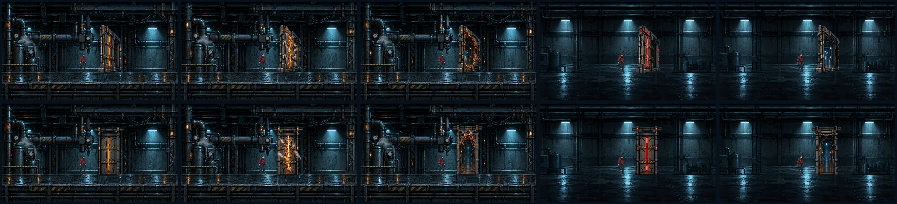

# Review batch: walking, doors, sounds, art plan (review page, October 10, 2026)

Markdown copy of the published page "WOLF//OVERRIDE Review Batch" shown to Nathanial on October 10, 2026. Scripts, styles and the page's audio players are dropped. Picked sounds link to the tracked WAVs in [`../../sources/sound-picks/`](../../sources/sound-picks/); clips that were not picked say "audio not kept". The walking previews (animated GIFs) were not kept: the same first-pass frames survive as contact sheets in [`../../sources/walk-first-pass-2026-10-10/`](../../sources/walk-first-pass-2026-10-10/). Clip descriptions were cut short on the page itself (the "…" marks); the full texts are in [`../../data/sound-redo.json`](../../data/sound-redo.json).

**Outcome.** Walking: the first-pass loops were judged too jittery and choppy and were redone (see [`2026-10-10-walk-door-death-picks.md`](2026-10-10-walk-door-death-picks.md)). Doors: design A, the bulkhead, was picked over B (record in [`../../sources/doors-A/`](../../sources/doors-A/)); door A was later replaced by the shutter door approved on October 11, round 4. Sounds: Nathanial picked the eleven sounds listed in [`../../sources/sound-picks/LICENCES.md`](../../sources/sound-picks/LICENCES.md) on October 10. Art plan: the style test went ahead (see [`2026-10-10-style-test.md`](2026-10-10-style-test.md)).

---

*Review batch · October 10, 2026*

Walking loops, the redesigned doors, the redone sounds and the high-quality art plan. Everything is in the scratchpad; nothing here is in the game yet.

## 1. Walking

First-pass loops made with Codex's hatch-pet pipeline, for judging the motion only. The final frames get remade at the art bible's quality: WOLF much larger and cleaner (these WOLF frames are too small and grainy), and the engineer without the faint cyan edge. In the game, frames will advance with distance walked, so feet don't slide, and footsteps play on the contact frames.

Six animated loops were shown (image not kept; frames in the contact sheets):

- **Engineer · idle**, **Engineer · walk**, **Engineer · jog**: [`engineer-contact-sheet.webp`](../../sources/walk-first-pass-2026-10-10/engineer-contact-sheet.webp)
- **WOLF · idle**, **WOLF · walk**, **WOLF · trot**: [`wolf-contact-sheet.webp`](../../sources/walk-first-pass-2026-10-10/wolf-contact-sheet.webp)

## 2. Doors that open onto a passage

Top row: **A, bulkhead** across the walkway in slight perspective (junction sealed, breaking, blown; corridor seal sealed, open). Bottom row: **B, shutter**. In both, the open or blown door now shows a lit passage beyond instead of the back wall. A reads more clearly as something you walk through.

## 3. Redone sounds

Each was rebuilt two ways: new synthesis in code, and real CC0 (public-domain) recordings processed for the game, with the licence noted. The chip shows the critic's measured ranking; your ear decides.

### Steam hiss (pressure line, vent, coolant cloud)

- **hiss_rec_pressure_loop_mid** · Recording (CC0) · #1 strong · 6 s · [hiss_rec_pressure_loop_mid.wav](../../sources/sound-picks/hiss_rec_pressure_loop_mid.wav)  
  top 1). The junction pressure-line loop at the mid gauge, from real CC0 steam recordings. A fuller steam hiss through the pipe with lively turbulence, light gurgle and a faint drifting valve whistle. The fixed 'honk' tone at 820-930 Hz is gone and the gurgle no longer rings at 490 Hz. The wrap now sits at an average-level point,…  
  *Licence:* CC0 (public-domain equivalent), Joseph Sardin, BigSoundBank/LaSonotheque (#0805 pressure cooker, #1486 air leak). Attribution optional but requested: 'Joseph Sa
- **hiss_rec_pressure_loop_low** · Recording (CC0) · #10 usable · 6 s · [hiss_rec_pressure_loop_low.wav](../../sources/sound-picks/hiss_rec_pressure_loop_low.wav)  
  gauge-set companion of top 1). The low-gauge pressure loop: dark, muffled steam with soft condensate gurgle and no whistle. The leak honk tone is gone and the gurgle is broader. Same layout and wrap point as mid and high, so the game can crossfade the three in sync. Also _22k and _x3_audition files  
  *Licence:* CC0 (public-domain equivalent), Joseph Sardin, BigSoundBank/LaSonotheque (#0805, #1486). Attribution optional but requested.
- **hiss_rec_pressure_loop_high** · Recording (CC0) · #7 usable · 6 s · [hiss_rec_pressure_loop_high.wav](../../sources/sound-picks/hiss_rec_pressure_loop_high.wav)  
  gauge-set companion of top 1). The high-gauge loop: bright, strained steam with the valve whistle at 1530 Hz. The 3-5 kHz pile (46% of the energy, the ear's most sensitive band, played at the loudest -8 dB gauge level) is tamed. Weight moves to 1-3 kHz, so it reads as more pressure and less shrill. Also _22k and _x3_audition  
  *Licence:* CC0 (public-domain equivalent), Joseph Sardin, BigSoundBank/LaSonotheque (#0805, #1486). Attribution optional but requested.
- **hiss_rec_vent_burst** · Recording (CC0) · #4 strong · 2.4 s · [hiss_rec_vent_burst.wav](../../sources/sound-picks/hiss_rec_vent_burst.wav)  
  top 2). The relief vent letting go. A slightly louder 0.2 s sputter, then the valve pops straight to full flow. Before, the blast took another 0.35 s to swell after the pop. It darkens as it bleeds off over about 2 s. The narrow 2-3 kHz 'kettle' honk is spread into 1-2 kHz, and the 8-9 kHz whine from the air-release crack is rem…  
  *Licence:* CC0 (public-domain equivalent), Joseph Sardin, BigSoundBank/LaSonotheque (#0138 compressed air, #0805 pressure cooker). Attribution optional but requested.
- **hiss_rec_coolant_cloud_bed** · Recording (CC0) · #14 usable · 8 s · [hiss_rec_coolant_cloud_bed.wav](../../sources/sound-picks/hiss_rec_coolant_cloud_bed.wav)  
  minor; same build script). The 8 s soft, rolling coolant-cloud steam bed. The old wrap fell in the deepest billow trough (-3.9 dB at the seam), so every start began in a lull. The loop is rotated to a median-level spot, and the leak honk is notched. Also _22k and _x3_audition  
  *Licence:* CC0 (public-domain equivalent), Joseph Sardin, BigSoundBank/LaSonotheque (#0805, #1486). Attribution optional but requested.
- **B-pressure_loop_mid** · Synthesis (code) · #12 usable · 6 s · audio not kept  
  top 3). The best synthesis loop, recipe B 'eddy cascade', at gauge 0.5. A living, shimmering jet whose peak sits about 1.2 kHz. The faint hole tone (about 1.48 kHz, +4 dB) now marks the mid gauge, so the three gauges differ by more than brightness. The fizz above 5 kHz is trimmed. Low and high are returned below. Also pressure_l…  
  *Licence:* Original procedural synthesis written for this project; no third-party audio. Uses published DSP algorithms (Simper SVF).
- **B-pressure_loop_low** · Synthesis (code) · #8 usable · 6 s · audio not kept  
  gauge-set companion of top 3). Recipe B at gauge 0.15: a dark, surging, chuffing low-pressure leak with a wet 380 Hz churn and no whistle. It has less sub-300 Hz weight, so it holds up better on small speakers. Also _x3  
  *Licence:* Original procedural synthesis; no third-party audio.
- **B-pressure_loop_high** · Synthesis (code) · #2 strong · 6 s · audio not kept  
  gauge-set companion of top 3). Recipe B at gauge 0.9: a bright, fast-shimmering jet whose hole tone hops between about 1.8 and 2.8 kHz. The 5 kHz+ fizz is cut from 13.6% to 8.1%, so it is less harsh at the -8 dB top of the gauge curve. Also _x3  
  *Licence:* Original procedural synthesis; no third-party audio.
- **A-coolant_cloud** · Synthesis (code) · #3 strong · 3 s · audio not kept  
  strong). Recipe A coolant cloud, a 3.0 s one-shot matched to DropArm.CLOUD_SECONDS. A soft puff, then a broad low-pressure hush with no whistle and a sparse 2.5-4.5 kHz condensation sizzle dying to silence. It is the best fit for the cloud as a one-shot. The rec bed above is the loop alternative  
  *Licence:* Original procedural synthesis; no third-party audio.
- **A-pressure_loop_high** · Synthesis (code) · #5 usable · 6 s · audio not kept  
  alternative flavour). Recipe A at gauge 0.9 has the strongest whistle identity in the set: a breathy 2.14 kHz whistle with a 4.4 kHz overtone over a steady hiss. Kept for comparison if Nathanial wants a more 'kettle/pressure valve' high end than B-high or the rec high. Tiled copy pressure_loop_high_x3.wav  
  *Licence:* Original procedural synthesis; no third-party audio.

### Electrical arc (relay spark, Records exit, exit bolt)

- **arc-synth-B-records_arc** · Synthesis (code) · #1 strong · 0.65 s · [arc-synth-B-records_arc.wav](../../sources/sound-picks/arc-synth-B-records_arc.wav)  
  critic rank 1, Records exit, plays at -3 dB with the flash). This is recipe B's physical discharge: an N-wave crack at 6 ms, an arc body pulsing at 120 Hz, a restrike at 0.15 s and a tail that thins out. Changes: - The housing ring is now a short knock instead of a 'ting'. The 1723 Hz line was 18-23 dB above its neighbours for a…  
  *Licence:* Original procedural code written for this pass, with no third-party audio or code copied. The output belongs to the project, like sfx_bank.gd.
- **arc-synth-A-records_arc** · Synthesis (code) · #2 strong · 0.65 s · audio not kept  
  critic rank 2, Records exit). Still the warmest and most bodied arc (about 49% in 300 Hz-1 kHz), but the hum now throbs at 120 Hz like a live arc instead of sitting as steady transformer hum under the noise. - The 120 Hz pulse share went from 0.095 to 0.576, and the envelope peak moved from 70 Hz to 120 Hz. - The pulses survive …  
  *Licence:* Original procedural code written for this pass, with no third-party audio or code copied. The output belongs to the project, like sfx_bank.gd.
- **arc-synth-A-relay_spark** · Synthesis (code) · #3 usable · 0.34 s · [arc-synth-A-relay_spark.wav](../../sources/sound-picks/arc-synth-A-relay_spark.wav)  
  critic rank 3, corridor relay contact). The critic's fix for this slot is a call-site change in main.gd line 1884: play(&"arc", -8.0, 1.2) becomes play(&"arc", -5.0, 1.0). The repo is read-only here, so that is a recommendation, not an edit.  The clip itself gets the same 120 Hz reignition pulse as A records, so the relay matche…  
  *Licence:* Original procedural code written for this pass, with no third-party audio or code copied. The output belongs to the project, like sfx_bank.gd. The context previ
- **arc-synth-C-relay_spark** · Synthesis (code) · #4 usable · 0.34 s · audio not kept  
  critic rank 4, usable), the alternative relay spark. Stylised: a click and a clipped burst, an FM 'pew', grain crackle and stuttering 'zzt-zzt' bursts at 0.09, 0.15 and 0.21 s. It separates best from the clank (69% in 1-5 kHz). But it has no mains periodicity (120 Hz share 0.045), and the FM 'pew' can read as a laser. The critic…  
  *Licence:* Original procedural code written for this pass, with no third-party audio or code copied. The output belongs to the project, like sfx_bank.gd.
- **arc_rec_records_exit** · Recording (CC0) · #5 usable · 0.65 s · audio not kept  
  critic rank 5, usable), the recorded alternative for the Records exit. A real CC0 crackle texture gated at 120 Hz, with a snap, a zap sweep and a second snap at 175 ms. Its weak points: - It is quiet: crest 18.1 dB, loudest 50 ms -16.9 dBFS. - 18.9% of its energy is still in 5-8 kHz. - Shipping it would add third-party audio and…  
  *Licence:* CC0: 'Electric Buzz' (themightyglider / soundtracvkradio) and rubberduck '50 CC0 Sci-Fi SFX'. Attribution is optional; it needs asset-register entries if shippe
- **arc-synth-C-records_arc** · Synthesis (code) · #6 usable · 0.65 s · audio not kept  
  critic rank 6, usable). A loud, punchy stylised Records arc with a clear restrike at 0.15 s. Its weak points: - The buzz is chopped into blocks with no mains periodicity. - 40% of its energy is in the harsh 2-5 kHz band. - Two late spits at 0.51-0.52 s sit about 14 dB above the tail.  The critic's unapplied fix: crackle floor 0 …  
  *Licence:* Original procedural code written for this pass, with no third-party audio or code copied. The output belongs to the project, like sfx_bank.gd.
- **arc-synth-B-bolt_arc** · Synthesis (code) · #7 usable · 0.8 s · [arc-synth-B-bolt_arc.wav](../../sources/sound-picks/arc-synth-B-bolt_arc.wav)  
  critic rank 7, usable), the best junction exit-bolt clip and the only bolt option on this page. It has the strongest mains pulse of any clip (120 Hz share 0.70) and its spits rise from -45 to -19 dB before a hard crack at 0.50 s.  Caution: in game, _bolt_arc() plays it when the 0.6 s whine ends, so the crack would land 0.5 s aft…  
  *Licence:* Original procedural code written for this pass, with no third-party audio or code copied. The output belongs to the project, like sfx_bank.gd.

### WOLF's growl (door seam, lane warning, refusal)

- **growl-rec-seam** · Recording (CC0) · #1 strong · 0.9 s · [growl-rec-seam.wav](../../sources/sound-picks/growl-rec-seam.wav)  
  critic rank 1, strong). WOLF reading the door seam. A low, closed-mouth real dog growl heard through a metal body. It is now deeper and heavier, with f0 near 100 Hz, falling from 105 to 91 Hz (it was 112 Hz). It has the same deep combs, 61 Hz ring mod and faint 1.1-1.7 kHz scanning servo whine as before. It now lasts 0.9 s inste…  
  *Licence:* CC0 1.0 (OpenGameArt page licence field 'License(s): CC0', linked to https://creativecommons.org/publicdomain/zero/1.0/). No attribution required; crediting pau
- **growl-synth-C-warning** · Synthesis (code) · #2 strong · 1.2 s · [growl-synth-C-warning.wav](../../sources/sound-picks/growl-synth-C-warning.wav)  
  critic rank 2, strong). The lane-choice warning growl, fully procedural. It keeps the same chaotic, subharmonic 74 Hz throat ringing a metal chassis. It now has a living contour instead of a held note: a slow wandering swell rises and falls with F1, then a dip and two snarl bursts at about 0.45 s and 0.8 s. In each burst the mou…  
  *Licence:* Original procedural synthesis written for this project; no third-party audio. Same provenance as sfx_bank.gd.
- **growl-rec-assertive** · Recording (CC0) · #3 usable · 0.92 s · [growl-rec-assertive.wav](../../sources/sound-picks/growl-rec-assertive.wav)  
  critic rank 3, usable). WOLF refusing or pushing back: a 4 ms bite attack with a quick servo jolt. One throat now leads. The Dog 2 snarl is pitched down to about 105-133 Hz under the bonebrah rasp. The bear is reduced to a high-passed texture, so it no longer adds a third pitch. It has a little more chest and slightly more edge …  
  *Licence:* CC0 1.0 for all three sources (each OpenGameArt page reads 'License(s): CC0' and links to https://creativecommons.org/publicdomain/zero/1.0/; the bear README re

## 4. High-quality asset plan

The audit measured every asset. The worst problems: WOLF's new frames are too small; the sentry wreck has a see-through band across its hull; the active sentry blends into the background; the title logo's ring breaks into dashes; characters have dark outlines and no top light; many props have a black edge fringe and are much brighter and warmer than the rooms; and the backgrounds and title art are slightly enlarged (soft) at 1080p.

The art bible fixes this with one sharpness rule per asset type, colours sampled from title art B, a top light and cyan rim on everything, solid bodies, no dark outlines, and an automatic quality check that catches every defect above. First comes a **style test**: one corridor slice with the engineer, WOLF and two stations in two looks, for you to choose before anything is redone in bulk.

The audit data is in [`../art-audit/`](../art-audit/) and the art bible in [`../../art-bible.md`](../../art-bible.md).

---

## Credits

- Game, story and every decision: Nathanial Henniges.
- Page, measurements and critic rankings: Claude (Claude Code) agents working for Nathanial.
- Walking loops: Codex's built-in image tool through the hatch-pet skill's scripts.
- Sounds: original procedural synthesis written for the project, and CC0 recordings by Joseph Sardin (BigSoundBank / LaSonotheque; attribution requested: "Joseph Sardin - BigSoundBank.com / LaSonotheque.org"), themightyglider and soundtracvkradio (OpenGameArt / Freesound), rubberduck (OpenGameArt), pauliuw, bonebrah and AntumDeluge / U.S. Fish & Wildlife Service (OpenGameArt). Full source pages, licences and SHA-256 are in [`../../sources/sound-picks/provenance/`](../../sources/sound-picks/provenance/) and [`../../sources/sound-picks/README.md`](../../sources/sound-picks/README.md).
