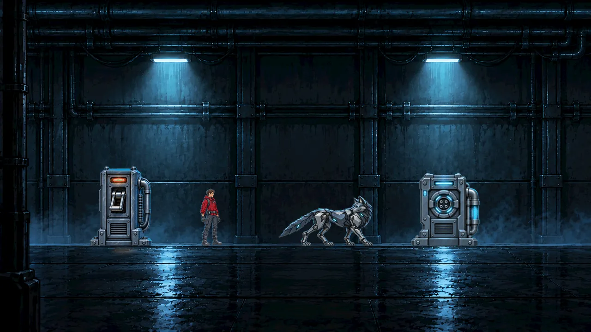
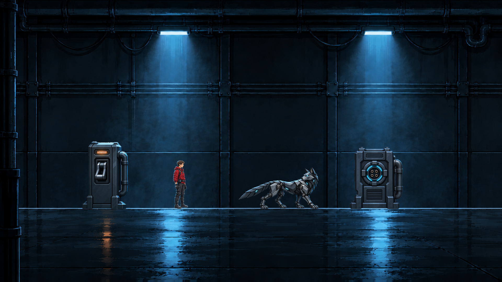

# Style test: Look 1 or Look 2 (review page, October 10, 2026)

Markdown copy of the page "WOLF//OVERRIDE Style Test" shown to Nathanial on October 10, 2026. Scripts and styles are dropped. Images point at the tracked or kept copies; the "before" capture and the 1920 previews of the page were not kept.

**Outcome.** Nathanial picked **Look 2 (graphic-painterly)**: every asset is redone in Look 2 with Codex's built-in image tool only (no API billing) (recorded under "Art" in [`../../README.md`](../../README.md)). Look 2's files are in [`../../sources/style-test-look2/`](../../sources/style-test-look2/); the rejected Look 1 is kept in [`../../sources/style-test-look1-rejected/`](../../sources/style-test-look1-rejected/).

---

*Art style test · October 10, 2026*

One corridor slice in two looks, made with Codex's built-in image tool from title art B and the approved corridor, characters and stations. Shown as a 1080p player sees it. Both pass the art bible's checks: no dark outlines, solid bodies, top light and cyan rim, the engineer and WOLF readable against the wall. The look you pick becomes the reference for redoing every asset.

## Today in the game

**Current build, 960x540** (image not kept). Soft characters, bright warm stations, fine grain that turns to noise at game size.

## Look 1: today's style, cleaned up

**1920x1080** (shown here at 1280). Same painterly texture as title art B with half the grain. The stations stay bright and silvery, so they stand apart from the room.

## Look 2: graphic-painterly

**1920x1080.** Flat value planes, minimal texture, crisp silhouettes; painterly only in light and atmosphere. The stations sit inside the room, and the light pools and reflections carry the mood.

## At small-screen size (960x540, shown 2x)

- **Look 1** (image not kept)
- **Look 2**: [`crop-960-2x.png`](../../sources/style-test-look2/crop-960-2x.png)

**Your call:** Look 1, Look 2, or a mix (for example Look 2 for the rooms and Look 1 for the characters and stations).

---

## Credits

- Game, characters and decisions: Nathanial Henniges.
- Art: Codex's built-in image tool, with title art B and the approved October 8-9 art as references; prompts and QA in each look's `notes.md`.
- Page: Claude (Claude Code) agent working for Nathanial.
