# Logic fixes, new doors and new lines (review page, October 11, 2026)

Markdown copy of the review page shown to Nathanial on October 11, 2026. The before and after captures are our own and are kept as WebP in [`../logic/fix-shots/`](../logic/fix-shots/) (the same folder also holds the final-route stills and grid from the verification pass). Not kept: the door round-3 plates (the round-3 compare sheet is tracked as [`../../sources/doors-rejected-rounds/round3-end-wall-compare.png`](../../sources/doors-rejected-rounds/round3-end-wall-compare.png), with its prompts in [`round3-end-wall-notes.md`](../../sources/doors-rejected-rounds/round3-end-wall-notes.md)) and the opening crops; their captions stay below. Outcomes: door round 3 (a door in an angled end wall) was rejected in favour of the round-4 shutter ([`2026-10-11-shutter-door-round-4.md`](2026-10-11-shutter-door-round-4.md)); the opening hatch was tried and removed ([`../../sources/opening-hatch-r3-removed/`](../../sources/opening-hatch-r3-removed/)); the new lines were approved and are tracked in [`../../approved/`](../../approved/). The final status of all 24 problems is in [`../logic/2026-10-11-logic-fix-verification.json`](../logic/2026-10-11-logic-fix-verification.json).

The page is kept as written. Where it says "he" for the engineer, note that since October 12 the engineer is non-binary (they/them). Spoilers: this page quotes story lines; keep it out of the website, in-game text and build output.

---

WOLF//OVERRIDE · October 11, 2026

# Logic fixes, new doors and new lines

The 24 problems from the screenshot audit were fixed with your four decisions and checked again from fresh in-game screenshots (454 of them, all four routes played to the end). A second round is fixing the last nine smaller issues now. Three things need you: the door, the opening, and the new lines.

1. Doors, round 3

The room ends in an angled wall with the door set into it.

Recommended: approve.

2. What the fixes changed

Eight before and after pairs from real captures.

Nothing to decide.

3. The opening

Where WOLF goes when the Director locks down maintenance.

Recommended: a hatch on the left.

4. New lines

108 new or changed lines, written in the approved voice.

Recommended: approve as drafted.

## 1. Doors, round 3

Your direction: the room ends in a side wall drawn at an angle, like the sets in Little Nightmares and Inside, and the door sits in that wall. You see the door's face, frame and lamp, the walkway runs straight into it, and when it opens or blows you see a lit passage beyond. It is built on the approved corridor art, so the back wall, lamps and floor match the game.

*(image not kept: Corridor end wall drawn at an angle with a closed door set into it, red lamp above)*

[CORRIDOR SEAL · CLOSED]

Red lamp, hazard-striped jambs.

*(image not kept: The same door open onto a lit amber passage, green lamp)*

[CORRIDOR SEAL · OPEN]

Leaf up into the frame, green lamp, the passage beyond lit.

*(image not kept: Heavy blast door with cross braces set into the angled end wall, two amber lamps)*

[JUNCTION BLAST DOOR · SEALED]

Heavier leaf with braces and two amber lamps.

*(image not kept: Blast door torn open and bent outward, debris and smoke, passage clear)*

[JUNCTION BLAST DOOR · BLOWN]

The leaf is torn and bent outward, the passage is clear to walk through.

*(image not kept: The four door scenes at the game's base size)*

**Recommendation: approve this direction.** It is the first door that reads as part of a wall and leads somewhere.

What it means for the build: a door in an end wall sits where a room ends. In the junction today the sealed door stands in the middle of one room with the sentry lane behind it, so this door comes with the planned junction rebuild into two chambers. Until then the merged build would keep the current door as a placeholder. These are concept scenes; the final pieces get redrawn in Look 2 as separate layers.

## 2. What the fixes changed

Left is the audit capture from October 10, right is the same moment in the fixed build. All from scripted play of the real game; nobody has played it by hand yet.

### Tank hit or miss now matches the screen

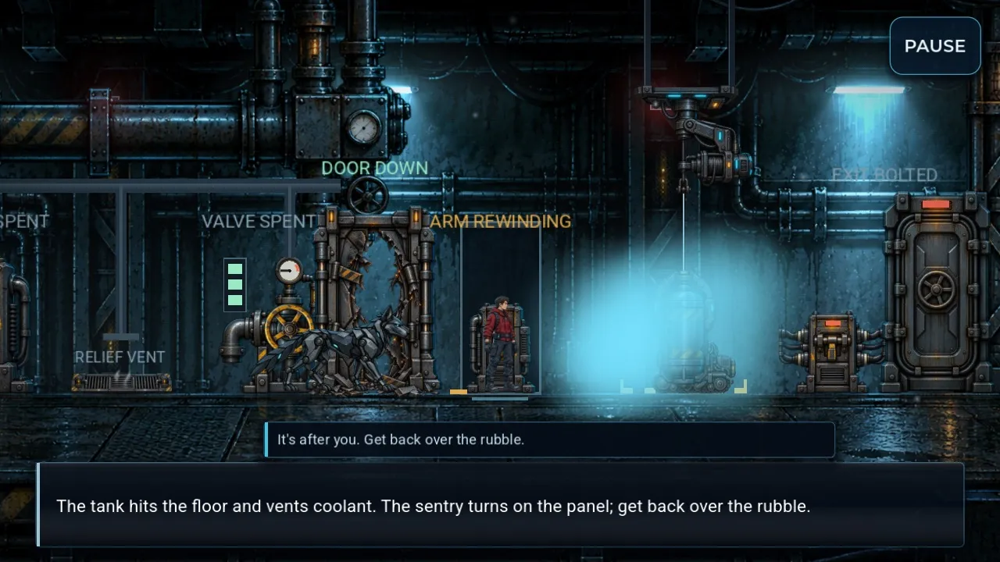

[BEFORE]

A sentry that looked covered got a miss, and an early drop could still hit.

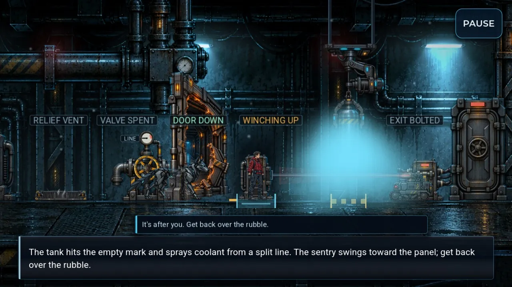

[AFTER]

The brackets are the tank's width and light up when the sentry is inside; while WOLF baits, the release waits until he has it stopped on the mark.

### The safe alcove is the drawn alcove

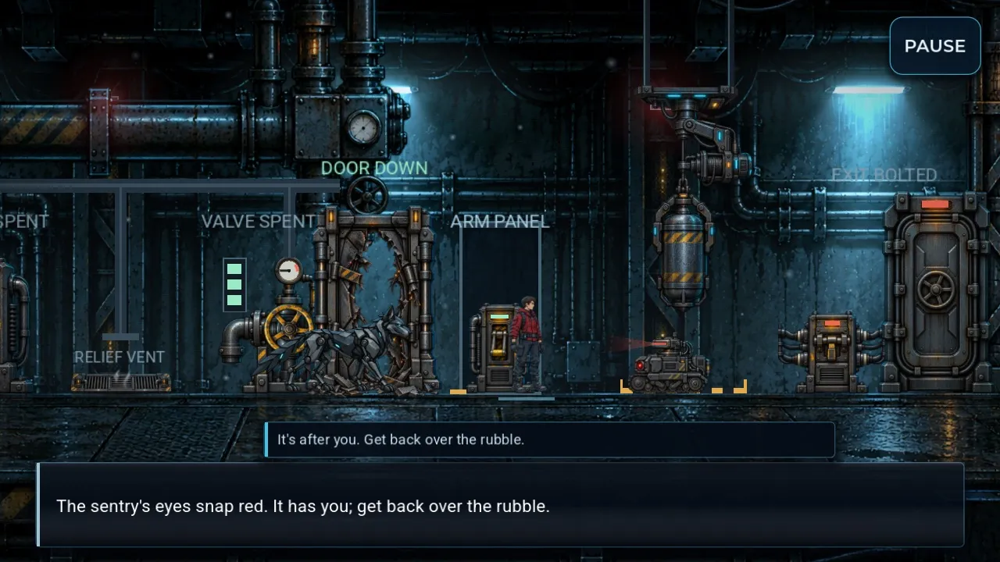

[BEFORE]

Spotted and run down inside the frame the game called safe.

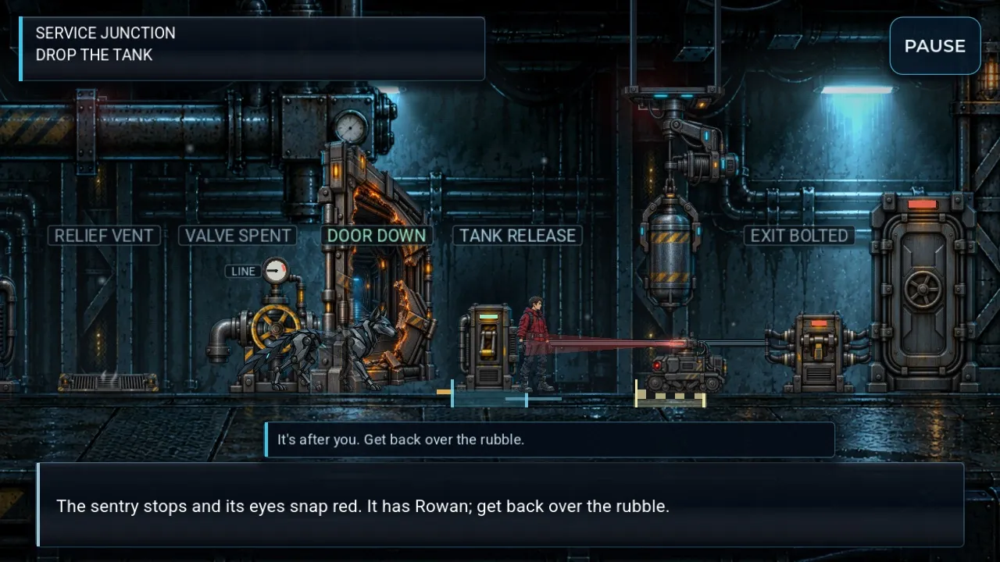

[AFTER]

Cover is exactly the tinted floor between the two posts; here the engineer is one step outside it.

### The door blast shows what hit you

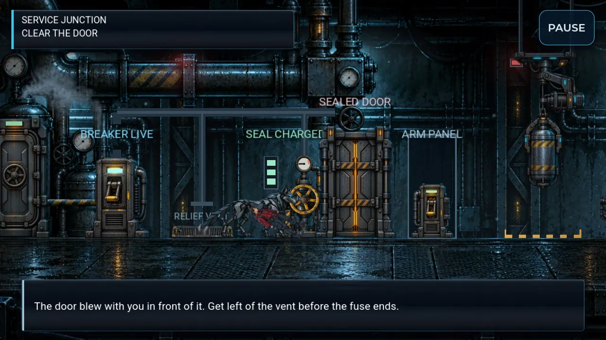

[BEFORE]

Knocked down while the door still looked sealed, told to get "left of the vent".

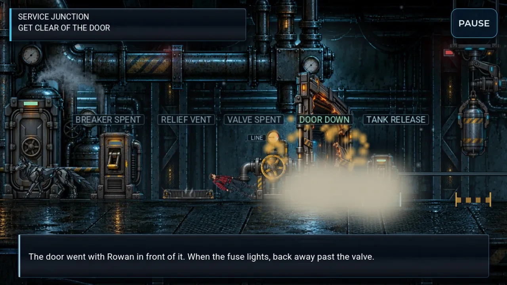

[AFTER]

The door blows first, pulsing stripes mark the blast zone, and the advice says to back away past the valve.

### The relay has stakes and its own bypass

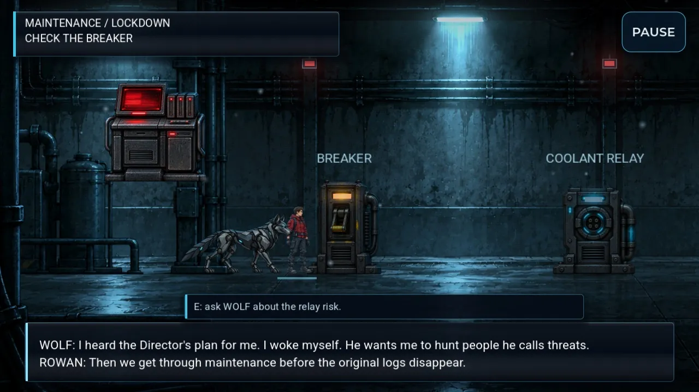

[BEFORE]

The bypass was the same box, free and instant, so asking WOLF meant nothing.

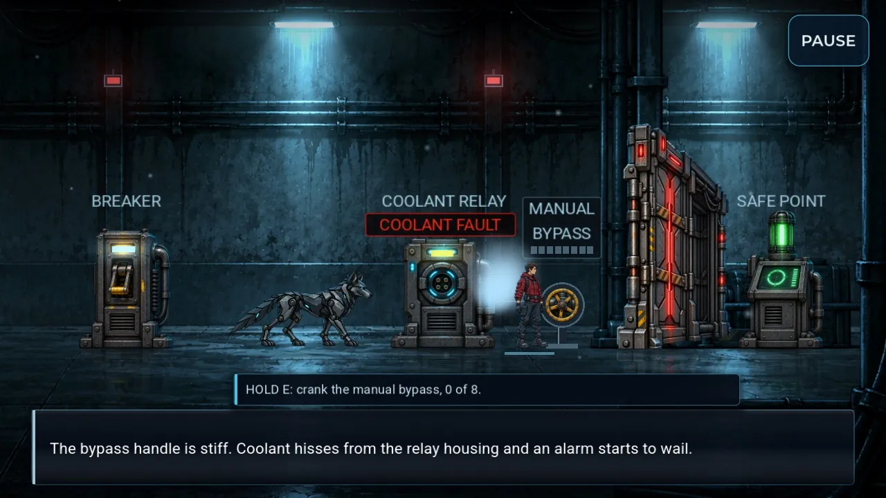

[AFTER]

A COOLANT FAULT tag and a separate MANUAL BYPASS wheel: eight held turns, coolant hissing and an alarm.

### WOLF holds the relay while the seal opens

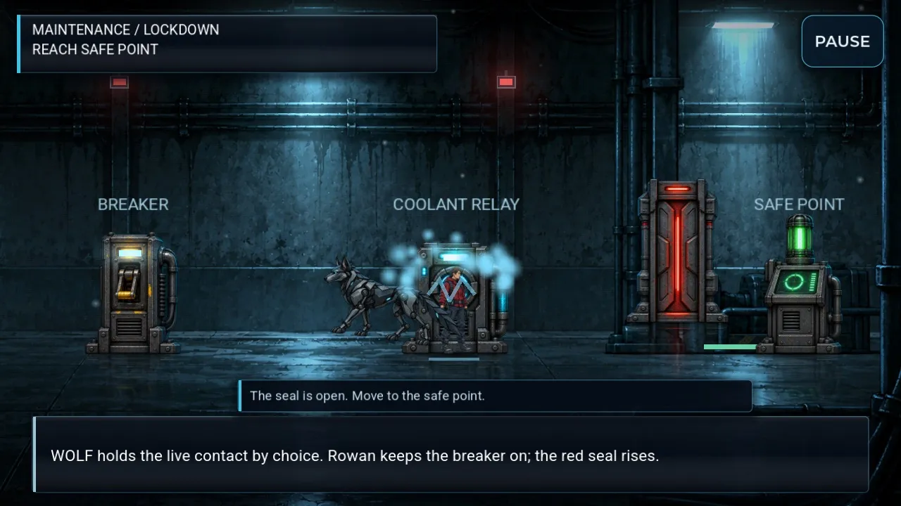

[BEFORE]

The line described WOLF on the contact while he was already walking away.

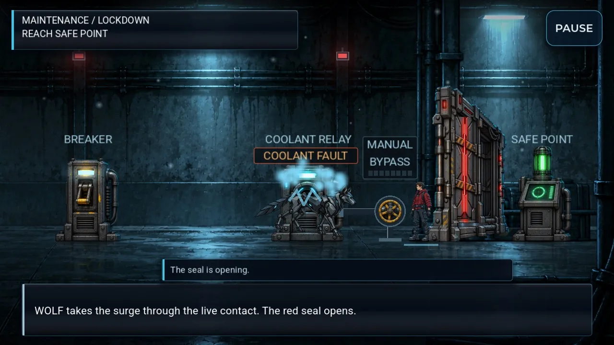

[AFTER]

He stays on the contact until the seal has slid up, and the hint says "opening" until it is open.

### Rowan gets introduced

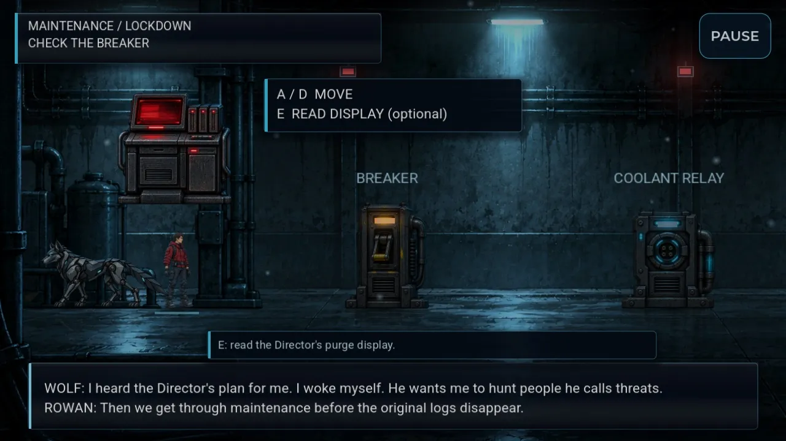

[BEFORE]

Control started with no word on who you are.

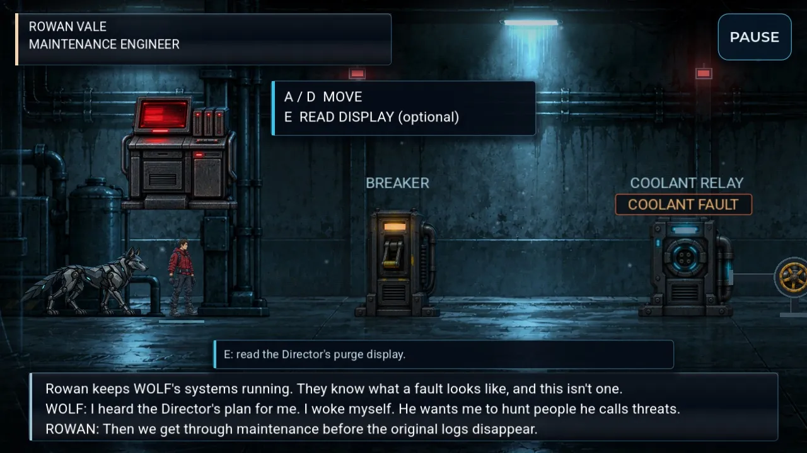

[AFTER]

A name card and one line on why they trust WOLF; the narration stays in the third person.

### The slice has an ending

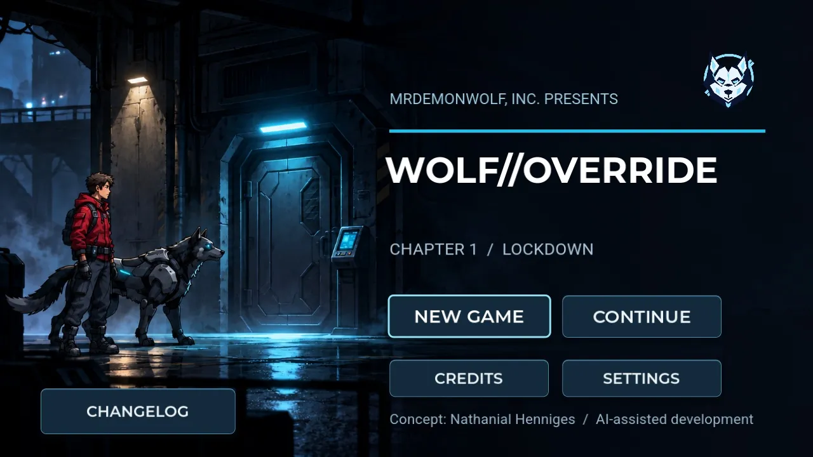

[BEFORE]

It cut to the title, and Continue led to "not built yet".

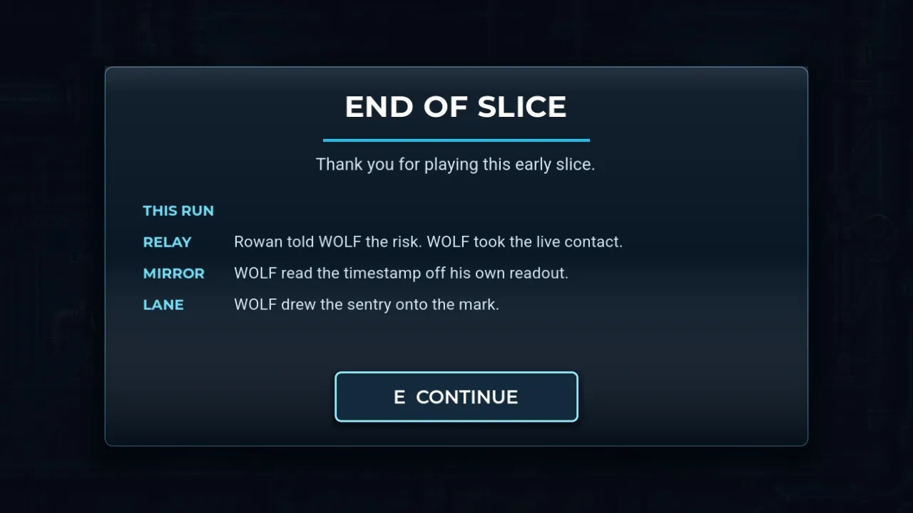

[AFTER]

END OF SLICE with your run's three choices, then the title, where a finished save offers PLAY AGAIN.

### WOLF's refusal changes the hint

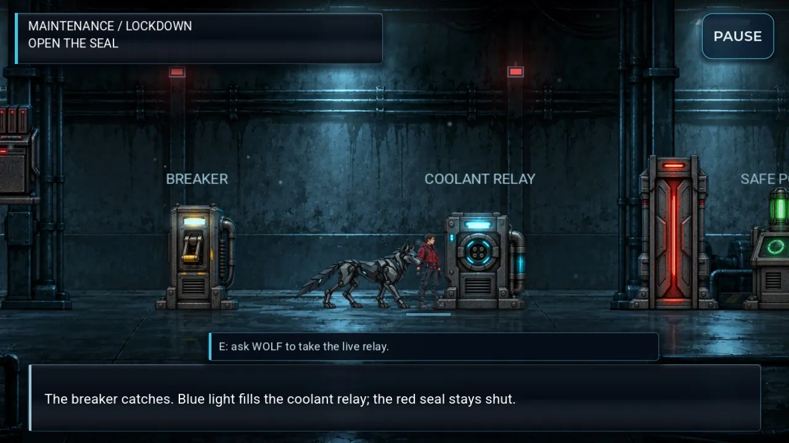

[BEFORE]

After WOLF refused, the hint still said to ask him, and his line named a key.

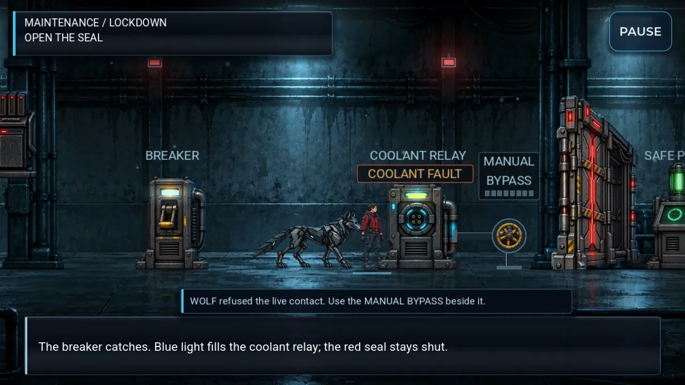

[AFTER]

The hint follows his answer and points at the bypass; WOLF never says key names.

Also fixed: vent steam and the LINE gauge, WOLF's bait spot, the mirror hint, narration under the Director's name, checkpoint wording with a "Checkpoint saved." note, Continue after the junction, label wording, the hatch timing and the exit bolt's power. Still open by design: the door art (above) and new station art for Records.

## 3. The opening

After the Director says "Lock down maintenance", WOLF walks back left toward his cage on "takes the only open route", and the scene cuts to the corridor. Nothing on screen shows where that route is.

*(image not kept: The Director orders the lockdown)*

[NOW · 1]

The Director, on the right, orders the lockdown.

*(image not kept: WOLF walks back left toward the cage)*

[NOW · 2]

WOLF walks back toward the cage, and the scene cuts.

## 4. New lines

108 lines, drafted in the voice of the approved death and item text. Rowan stands in for whichever provisional name is set, and the engineer is always they/them. Every line was measured to fit its box at 960×540 with the longest name. The first tables are the story lines (71); the hints and labels (37) are folded at the end.

### Opening, name card and stakes 7

| Who | Line | When it shows |
|---|---|---|
| Card | ROWAN VALE MAINTENANCE ENGINEER | Once, when control first passes to the engineer after the opening fade (New Game only; not on Continue). |
| Narration | Rowan keeps WOLF's systems running. They know what a fault looks like, and this isn't one. *Alternatives:* Rowan has serviced WOLF's systems without ever being told what they were for. Now WOLF has told them, and refused it. · Rowan knows WOLF from the inside, every joint and patch. Nothing in him reads as a malfunction. | Same moment as NAME_CARD: the first row of the opening gameplay box, above WOLF's existing line. |
| Narration | Rowan keeps WOLF's systems running. They know what a fault looks like, and this isn't one. WOLF: I heard the Director's plan for me. I woke myself. He wants me to hunt people he calls threats. ROWAN: Then we get through maintenance before the original logs disappear. *Was:* WOLF: I heard the Director's plan for me. I woke myself. He wants me to hunt people he calls threats. ROWAN: Then we get through maintenance before the original logs disappear. | The opening gameplay box, replacing the current two-row WOLF / engineer exchange. |
| WOLF | WOLF: That purge takes the original program logs. Once they're gone, his word is the only record. *Alternatives:* WOLF: That display is the Director's purge. Without the original logs, nobody can check who he calls a threat. · ROWAN: He's purging the original program logs. We save what we can before they're gone. | Once per run, the first time the engineer walks right past the purge display (x > 230) after the opening box. The engineer spawns at x 160, inside the display's reach, so it cannot fire on spawn. Never repeats; not on the purge display read. |
| Director | DIRECTOR / PURGE: Original program logs marked for deletion. WOLF: They want the source record gone. We need to preserve it. | USE at the purge display (optional). |
| Director | DIRECTOR: I decide who counts as a threat. WOLF handles the rest. The Director thinks WOLF is still in standby. *Was:* DIRECTOR: I decide who counts as a threat. WOLF handles the rest. He thinks WOLF is still in standby. *Alternatives:* Split into two beats: 'DIRECTOR: I decide who counts as a threat. WOLF handles the rest.' then the narration 'The Director thinks WOLF is still in standby.' | First opening beat. |
| Director | DIRECTOR: Lock down maintenance. WOLF does not leave this site. WOLF turns from the Director and heads for maintenance. *Was:* DIRECTOR: Lock down maintenance. WOLF does not leave this site. WOLF turns from him and takes the only open route. *Alternatives:* DIRECTOR: Lock down maintenance. WOLF does not leave this site. WOLF turns from the Director and takes the only open route. | Fourth opening beat. |

### Corridor relay and bypass 14

| Who | Line | When it shows |
|---|---|---|
| WOLF | WOLF: That relay's tagged COOLANT FAULT. What happens if I touch it live? *Was:* WOLF: You know what 'coolant fault' means. What happens if I touch the live relay? *Alternatives:* WOLF: You know what 'coolant fault' means. What happens if I touch the live relay? | USE at the breaker the first time (opens the relay choice). |
| WOLF | WOLF: No. I won't take that risk blind. Use the manual bypass. *Was:* WOLF: No. I won't take that risk blind. Use the bypass. *Alternatives:* WOLF: Not blind. The bypass handle by the relay is yours. | After choice 2 ('Go now. We can talk after.'). |
| WOLF | WOLF: I said no. I won't touch it blind. The bypass is right beside it. *Was:* WOLF: I said no. I won't take the live contact. Press E again for the manual bypass. *Alternatives:* WOLF: Still no. The bypass is yours. | USE at the relay on the press route. |
| Narration | The bypass handle won't move. The breaker has to be on first. | USE at the handle before the breaker is armed. |
| Narration | The bypass handle is stiff. Coolant hisses from the relay housing and an alarm starts to wail. *Alternatives:* Rowan leans on the bypass handle. Coolant hisses out of the relay and an alarm starts up. | The first crank tick (or a plain USE tap at the armed handle). |
| Narration | Halfway. The hiss gets louder; the alarm keeps wailing. *Alternatives:* The handle grinds round. The alarm doesn't let up. | Once, when the crank passes half way. |
| Narration | The handle holds where Rowan left it. The alarm keeps going. | When the engineer lets go or steps away before the crank is done. |
| Narration | The bypass locks over and the alarm cuts out. The red seal opens. WOLF: Open. I'm with you. *Was:* Rowan takes the bypass. WOLF reads the opening seal: "Open. I'm with you." *Alternatives:* Rowan hauls the bypass home. The alarm dies and the red seal opens. WOLF: The slow way works too. I'm with you. | When the last crank tick lands and the seal opens on the engineer-only route. |
| Narration | WOLF takes the surge through the live contact. The red seal opens. *Was:* WOLF holds the live contact by choice. Rowan keeps the breaker on; the red seal opens. *Alternatives:* WOLF holds the live contact by his own choice. The red seal opens. | When WOLF reaches the live contact and the seal opens. |
| Narration | The relay is dark. Arm the breaker first. *Was:* The relay is dark. Speak at the breaker and arm the power first. | USE at the relay before the breaker is armed. |
| Narration | No station in reach. Follow the labeled breaker, relay, bypass or safe point. *Was:* No station in reach. Follow the labeled breaker, relay or safe point. | USE away from every corridor station. |
| Card | SAFE POINT REACHED *Was:* CORRIDOR CLEARED | Top card after the corridor safe point. |
| WOLF | WOLF: You said "Go now. We can talk after." I refused. You found another way. Next time, tell me what it costs. *Was:* WOLF: You said "Go now. We can talk after." I refused. You found another way. *Alternatives:* WOLF: You said "Go now. We can talk after." I refused. You found another way. This is after, by the way. | Safe point saved / restored, press route. |
| WOLF | WOLF: You said "The relay may vent coolant. Your call." I made my call. You cranked the bypass anyway. I stayed. *Was:* WOLF: You said "The relay may vent coolant. Your call." You took the bypass. I stayed with you. *Alternatives:* WOLF: You said "The relay may vent coolant. Your call." I offered. You took the slow way. I stayed with you. | Safe point saved / restored when WOLF was told the risk but the engineer cranked the bypass anyway (audit route R4). |

### Records Access 5

| Who | Line | When it shows |
|---|---|---|
| WOLF | WOLF: I took the relay because you told me the truth. Take the purge queue. I'll inspect the mirror. *Was:* WOLF: I chose the relay. I'm checking this path too. Take the purge queue. I'll inspect the mirror. *Alternatives:* WOLF: I chose the relay. I'll choose my part here too. Take the purge queue. I'll inspect the mirror. | Entering Records Access after WOLF took the relay. |
| WOLF | WOLF: I offered the relay; you cranked the bypass. Still with you. Take the purge queue. I'll inspect the mirror. *Was:* WOLF: You used the manual bypass. I'm checking this path with you. Take the purge queue. I'll inspect the mirror. | Entering Records Access after the engineer cranked the bypass although WOLF offered. |
| Narration | WOLF reads the timestamp off his own readout. The purge target existed before the deletion order. *Was:* WOLF brings the mirror timestamp by his own choice. The purge target existed before the deletion order. *Alternatives:* The mirror timestamp shows the purge target existed before the deletion order. WOLF reads it out by his own choice. | After choosing USE WOLF'S READOUT. |
| WOLF | WOLF: The mirror kept its own time. He can't say that record never existed. *Alternatives:* WOLF: The target was on file before the order. This was planned, not a reaction to me. | Directly after either mirror result line (or as its second row). |
| WOLF | FIRST COPY SECURED. WOLF: An order and a timestamp don't tell me who's a threat. I want the source. ROWAN: Then Archive is next. *Was:* FIRST COPY SECURED. WOLF: A list doesn't tell me who's a threat. I want the source. ROWAN: Then Archive is next. *Alternatives:* FIRST COPY SECURED. WOLF: Two traces don't tell me who's a threat. I want the source. ROWAN: Then Archive is next. | Securing the first copy at the Records exit. |

### Service Junction 27

| Who | Line | When it shows |
|---|---|---|
| Narration | WOLF runs ahead to read the pressure behind the sealed door. ROWAN: The breaker by the entrance feeds that line. Overload it, crank the valve, and the door goes. *Was:* WOLF runs ahead to read the pressure behind the sealed door. ROWAN: The breaker on the left feeds that line. Overload it, crank the valve, and the seal goes. | Entering the Service Junction. |
| Narration | Service junction restored. Arm the breaker by the entrance, then crank the valve. WOLF: It's live. Don't stand in front of it when it goes. *Was:* Service junction restored. Arm the breaker on the left, then crank the valve by the door. | Continue from junction autosave A. |
| Narration | The overload breaker catches and the line starts to build. If the LINE gauge peaks, the relief vent lets go. *Was:* The overload breaker catches. The line starts to build; the relief vent lets go at the top of the gauge. *Alternatives:* The overload breaker catches. Watch the LINE gauge: the relief vent lets go when it peaks. | Arming the overload breaker. |
| Narration | The wheel is stiff. Three full turns charge the door. *Was:* The wheel is stiff. Hold USE to crank it; three real turns charge the seal. | USE at the valve while the line builds. |
| Narration | FUSE LIT. Back away from the door, past the valve. *Was:* SEAL CHARGED. Get left of the vent before the fuse ends. | The third valve turn lights the fuse (with the klaxon). |
| Narration | Fuse lit. Get clear of the door. *Was:* Seal charged. Get left of the vent before the fuse ends. | USE at the breaker or valve after the fuse is lit. |
| Narration | The door went with Rowan in front of it. When the fuse lights, back away past the valve. *Was:* The door blew with you in front of it. Get left of the vent before the fuse ends. *Alternatives:* The door blew with you in front of it. When the fuse lights, back away past the valve. | Knockdown card when the engineer is in the blast span as the fuse ends. |
| Card | CRANK THE VALVE *Was:* CHARGE THE SEAL | Top card while the line builds. |
| Card | GET CLEAR OF THE DOOR *Was:* CLEAR THE DOOR | Top card while the fuse burns. |
| Card | ARM THE BREAKER *Was:* CLEAR THE LINE | Top card on entering the junction or after a trip. |
| Narration | The valve is dead. Arm the overload breaker by the entrance first. *Was:* The valve is dead. Arm the overload breaker on the left first. | USE at the dead valve. |
| Narration | The vent let go and the breaker tripped. Reset it by the entrance. *Was:* The vent let go and the breaker tripped. Reset it on the left. | USE at the valve after a trip. |
| Narration | No station in reach. The breaker is by the entrance, the valve by the door. *Was:* No station in reach. The breaker is on the left, the valve by the door. | USE away from every junction station before the blast. |
| Narration | The door goes. WOLF stops at the rubble and waits for Rowan's call. In the lane beyond, something whirs awake. *Was:* The seal goes. WOLF holds at the rubble and will not cross; something answers from the dark past the door. *Alternatives:* The door goes. WOLF stops at the rubble and waits for Rowan's call; something answers from the dark past the door. | The door blows (autosave B). |
| Card | CHECK THE LANE *Was:* DROP THE TANK | Top card from the blast until WOLF asks how to bring the sentry down. |
| WOLF | WOLF: You told me the truth at the relay. I'll draw it onto the mark and keep clear of the tank. Drop it when it stops. *Was:* WOLF: I'll draw it onto the mark and keep clear of the tank. Drop it when it stops. | Answer 1 when WOLF was told the risk at the relay (memory choice_id == DISCLOSE; includes the route where the engineer cranked the bypass anyway). |
| WOLF | WOLF: At the relay you'd have sent me in blind. I won't walk into its sights. Time the drop from the panel; it crosses the mark on every pass. *Was:* WOLF: No. I won't walk into its sights. It crosses the floor mark on every pass; you can time the drop from the panel. *Alternatives:* WOLF: You didn't tell me the risk at the relay. I'm not walking into its sights. Time the drop from the panel. | Answer 1 when the engineer pressed WOLF without warning at the relay. |
| Narration | Wait. WOLF hasn't got it on the mark yet. | USE at the TANK RELEASE while WOLF baits but the sentry is not yet parked on the mark. |
| Narration | The tank hits the empty mark and sprays coolant from a split line. The sentry swings toward the panel; get back over the rubble. *Was:* The tank hits the floor and vents coolant. The sentry turns on the panel; get back over the rubble. *Alternatives:* The tank dents on the empty mark and sprays coolant from a split line. The sentry swings toward the panel; get back over the rubble. | The tank lands with the sentry outside the brackets. |
| Narration | The sentry loses Rowan behind the rubble and rolls back to its patrol. *Was:* It lost you and goes back to its patrol. The ARM PANEL alcove hides you from it. | The sentry gives up a chase. |
| Narration | The sentry stops and its eyes snap red. It has Rowan; get back over the rubble. *Was:* The sentry stops and its eyes snap red. It has you; get back over the rubble. *Alternatives:* The sentry stops and its eyes snap red. It has you; get back over the rubble. | The sentry locks on. |
| Narration | No station in reach. The TANK RELEASE is in the alcove past the rubble. *Was:* No station in reach. The ARM PANEL is in the alcove past the rubble. | USE away from stations after the blast. |
| Narration | The winch has the tank back on the clamp. The TANK RELEASE is ready again. *Was:* The winch has the tank back on the clamp. The ARM PANEL is ready again. | The winch has the tank back on the clamp. |
| Narration | With the tank down, the winch's power reroutes to the exit bolt. The panel whines. *Was:* The spare overload runs into the exit bolt. The panel whines. *Alternatives:* The tank release hands its power to the exit bolt. The panel whines. | USE at the exit bolt once the sentry is down. |
| Narration | The bolt is taking the charge. *Was:* The bolt is taking the overload. | While the bolt charges (USE or hint). |
| Narration | The bolt arcs and drops. *Was:* The bolt arcs and drops. The hatch slides open. | The whine peaks and the bolt drops. |
| Narration | The bolt arcs and drops. The hatch slides open. | When the hatch art has actually opened. |

### Saving, end of slice and title 18

| Who | Line | When it shows |
|---|---|---|
| Narration | The service line runs on toward Archive. *Was:* The service line runs on past the hatch. That part is not built yet. | Only reachable on a cleared junction save; decision D makes Continue start a fresh run instead. |
| Title | No checkpoint yet. Saving starts at the first SAFE POINT. *Was:* No checkpoint yet. Reach a SAFE POINT to save. *Alternatives:* No checkpoint yet. Reach the first SAFE POINT. | Title screen with no save. |
| Narration | Back at the last checkpoint. *Was:* Back at the last autosave. | After a knockdown restores from the save file. |
| Narration | Back at the start of this stretch. *Was:* Back at the start of this beat. | After a knockdown before the first checkpoint (beat snapshot). |
| Card | END OF SLICE | After the SERVICE LINE CLEARED beat, before the title. |
| Card | Thank you for playing this early slice. *Alternatives:* THANK YOU FOR PLAYING · Thank you for playing. The story continues in a later build. | Under END OF SLICE. |
| Card | THIS RUN *Alternatives:* YOUR CHOICES | Above the recap rows. |
| Card | RELAY Rowan told WOLF the risk. WOLF took the live contact. | Recap row, relay. |
| Card | RELAY Rowan told WOLF the risk, then cranked the bypass anyway. | Recap row, relay. |
| Card | RELAY Rowan rushed WOLF. He refused, so Rowan cranked the bypass. | Recap row, relay. |
| Card | MIRROR WOLF read the timestamp off his own readout. | Recap row, mirror. |
| Card | MIRROR Rowan copied the timestamp through the maintenance port. | Recap row, mirror. |
| Card | LANE WOLF drew the sentry onto the mark. | Recap row, lane. |
| Card | LANE WOLF wouldn't draw it, so Rowan timed the drop alone. | Recap row, lane. |
| Card | LANE WOLF held at the rubble while Rowan timed the drop. | Recap row, lane. |
| Card | LANE The tank came down on the sentry. | Recap row, lane, fallback. |
| Title | PLAY AGAIN *Was:* CONTINUE *Alternatives:* CONTINUE | Title screen when the save is a finished slice. |
| Title | Slice complete. PLAY AGAIN starts a fresh run. *Alternatives:* Slice complete. Continue starts a fresh run. | Title screen note under the button, finished save. |

Hints and labels (37)

| Type | Line | When it shows |
|---|---|---|
| Label | COOLANT FAULT *Alternatives:* FAULT: COOLANT | Always visible on the relay in the corridor, from the start of control. |
| Label | MANUAL BYPASS *Alternatives:* BYPASS | Always visible on the new handle beside the relay. |
| Hint | E: talk to WOLF about the relay. *Was:* E: ask WOLF about the relay risk. | At the breaker before the relay conversation. |
| Hint | E: signal WOLF to take the contact. *Was:* E: ask WOLF to take the live relay. *Alternatives:* E: tell WOLF the relay is live. | At the relay on the disclose route, breaker armed, before WOLF moves. |
| Hint | WOLF is moving to the contact. *Was:* WOLF is moving to the contact. E: take the manual bypass instead. *Alternatives:* WOLF is moving to the contact. The bypass is still yours. | At the relay while WOLF walks to the contact. |
| Hint | WOLF refused the live contact. Use the MANUAL BYPASS beside it. *Was:* E: take the manual bypass. WOLF refused the live contact. | At the relay on the press route, from the moment WOLF refuses at the breaker (memory choice_id == PRESS), not only after a second refusal. |
| Hint | The breaker is live. Go to the MANUAL BYPASS by the relay. *Was:* The breaker is live. Go to the coolant relay. | At the breaker after arming it, press route. |
| Hint | Go to the coolant relay. WOLF is ready for the contact. *Was:* Go to the live coolant relay. WOLF is with you. | Walking between stations after arming, disclose route. |
| Hint | Go to the MANUAL BYPASS beside the relay. *Was:* Go to the live coolant relay. WOLF is with you. | Walking between stations after arming, press route. |
| Hint | The bypass is dead. Arm the breaker first. | At the handle before the breaker is armed. |
| Hint | HOLD E: crank the manual bypass, {ticks} of {needed}. | At the handle with the breaker armed, press route (and disclose route once WOLF has been signalled). |
| Hint | HOLD E: crank it yourself, or let WOLF take the relay. *Alternatives:* HOLD E: crank the bypass. WOLF can take the relay faster. | At the handle on the disclose route before WOLF has taken the contact. |
| Hint | The seal is opening. *Was:* The seal is open. Move to the safe point. | While the seal is still opening. |
| Hint | Mirror copied. Head for the exit. *Was:* E: examine the mirror port. | At the mirror port after the mirror timestamp is copied. |
| Label | LINE | Always, on the valve's dial. |
| Hint | Relief vent. Get off the grate before the gauge peaks. *Was:* Relief vent. Move off it before the gauge peaks. | Standing on the grate while the line builds. |
| Hint | The vent is about to blow. Get off the grate now. | On the grate in the last moments before the vent lets go (with the hiss spike or flash). |
| Hint | Fuse lit. Get clear of the door. *Was:* Fuse lit. Get left of the vent, away from the door. *Alternatives:* Fuse lit. Back away past the valve. | Any position while the fuse burns. |
| Label | FUSE LIT *Was:* SEAL CHARGED | Valve plate once the seal is charged. |
| Hint | The valve is dead. Arm the breaker by the entrance. *Was:* The valve is dead. Arm the breaker on the left. | At the dead valve. |
| Hint | The breaker tripped. Reset it by the entrance. *Was:* The breaker tripped. Reset it on the left. | Anywhere after a trip. |
| Hint | Arm the breaker by the entrance, then crank the valve by the door. *Was:* Arm the breaker on the left, then crank the valve by the door. | Junction default hint. |
| Label | Draw it under the tank if you can stay clear. *Was:* Draw it under the arm if you can stay clear. *Alternatives:* Draw it under the tank. Keep clear of it. | Lane choice, answer 1 (also shown on the choice button). |
| Hint | Wait for WOLF to park it on the mark. *Was:* E: drop the tank. It lands on the floor mark. | Standing at the TANK RELEASE while WOLF draws the sentry in. |
| Hint | E: drop the tank. It's parked on the mark. *Was:* E: drop the tank. It lands on the floor mark. | Standing at the TANK RELEASE once the sentry stops on the mark. |
| Hint | E: drop the tank. It must land with the sentry in the brackets. *Was:* E: drop the tank. It lands on the floor mark. *Alternatives:* E: drop the tank. Time it to land with the sentry in the brackets. | Standing at the TANK RELEASE while the sentry patrols (WOLF refused, held back or broke off). |
| Label | TANK RELEASE *Was:* ARM PANEL | The panel plate in the alcove, idle state. |
| Label | WINCHING UP *Was:* ARM REWINDING | Panel plate while the winch hauls the tank back. |
| Label | RELEASE SPENT *Was:* TANK DOWN | Panel plate after the hit. |
| Label | TANK DOWN | Over the tank once it is down on the sentry. |
| Hint | The winch is hauling the tank back up. Wait for the clamp. *Was:* The arm is rewinding. Wait for the clamp. | At the release while the tank is winched back up. |
| Hint | You're in its lane. Get into the release alcove or back over the rubble. *Was:* You're in its lane. Get into the panel alcove or back over the rubble. | Standing in the sentry's lane outside the alcove. |
| Hint | WOLF is drawing the sentry onto the mark. Get to the TANK RELEASE. *Was:* WOLF is drawing the sentry onto the mark. Get to the ARM PANEL. | Away from the release while WOLF draws the sentry. |
| Hint | WOLF has broken off. Time the drop on its patrol from the TANK RELEASE. *Was:* WOLF has broken off. Time the drop on its patrol from the ARM PANEL. | After WOLF breaks off from a miss. |
| Hint | The sentry patrols past the rubble. The TANK RELEASE is in the alcove just inside. *Was:* The sentry patrols past the rubble. The ARM PANEL is in the alcove just inside. | Lane default hint. |
| Hint | Checkpoint saved. *Alternatives:* CHECKPOINT SAVED | Each successful autosave in Records and the Service Junction (not the corridor safe point, which already says 'Safe point saved.'). |
| Hint | E: CONTINUE | Bottom of the end card. |

**Your calls**

The door, the opening, the lines, and whether the fixed build can merge with the current door as a placeholder. I'm asking all four in the chat.

---

Credits: fixes, captures and page by Claude (Claude Code) for Nathanial Henniges, from scripted play of the Godot build; the door round-3 concepts were painted with Codex's built-in image tool. Little Nightmares (Tarsier Studios, 2017) and Inside (Playdead, 2016) are named as references only.
