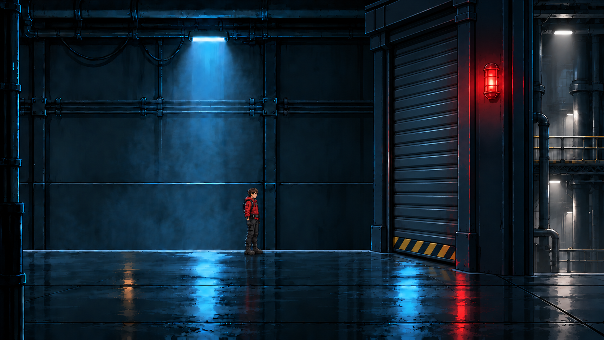
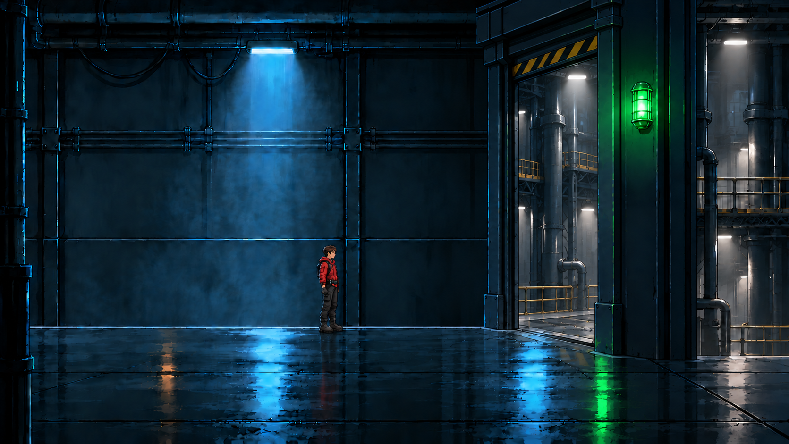
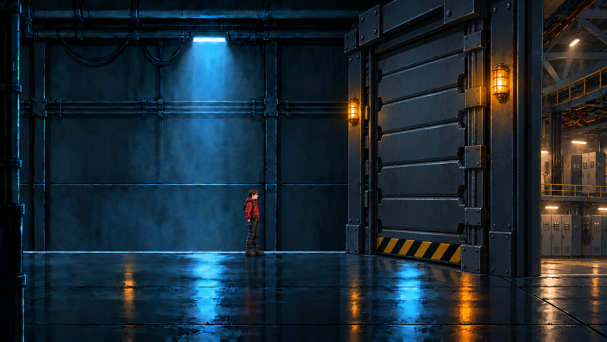
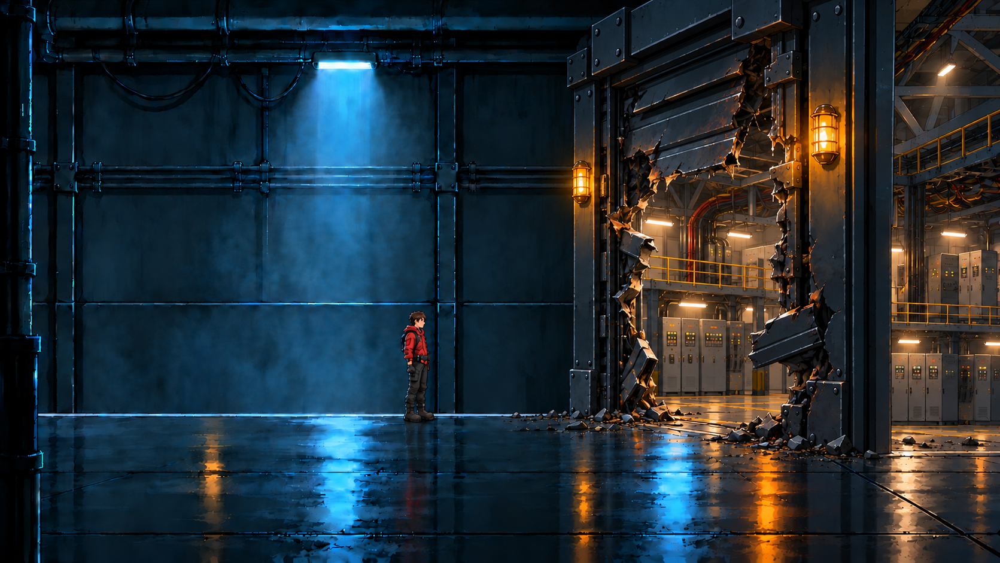
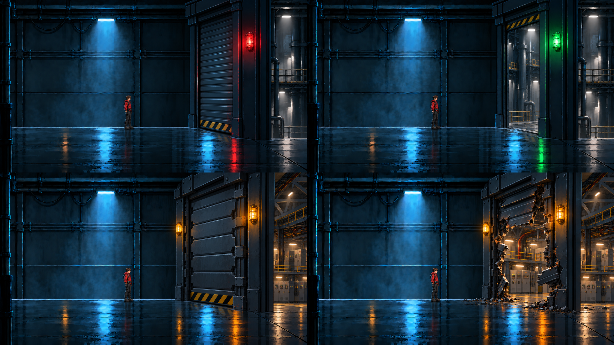

# Shutter door, round 4 (review page, October 11, 2026)

Markdown copy of the review page "Shutter Door Round 4" that was shown to Nathanial on October 11, 2026. The page's JPEG previews are not kept; the images below are the full-size round-4 concepts already tracked in [`sources/doors-shutter-approved/`](../../sources/doors-shutter-approved/). Outcome: Nathanial approved this direction the same day (see the "Art" decision in [`../../README.md`](../../README.md)); the layer work that followed is in [`sources/shutter-door-layers-2026-10-11/`](../../sources/shutter-door-layers-2026-10-11/) and is on hold under `art-direction/REAL-LOOK.md`.

---

*WOLF//OVERRIDE · Doors · October 11, 2026*

## The shutter across the corridor

Your pick from the four door ideas: a wide steel shutter that fills the whole passage, like Inside and Limbo, and rises or gets blown open. It is drawn on the approved corridor art. The corridor narrows into a heavy portal, the shutter fills it from floor to header, and you see its slats, rails and hazard edge at a slight angle. Beyond it is a different hall, not the same wall tinted.

| | |
|---|---|
|  **CORRIDOR SEAL · CLOSED.** Shutter down, red lamp, the hall beyond only glimpsed past the frame. |  **CORRIDOR SEAL · OPEN.** Rolled up into the header, green lamp, the walkway runs into the hall. |
|  **JUNCTION BLAST SHUTTER · SEALED.** Heavier armored segments and two amber lamps. |  **JUNCTION BLAST SHUTTER · BLOWN.** Buckled and torn toward the hall, debris on the floor, a clear way through. |

### At the game's size

**Recommendation: approve this direction.** The shutter fills the passage, so it can't read as a pillar. You see its face, and the space beyond is a real second place.

If you approve, the corridor seal, the Records doors and the junction blast shutter get redrawn this way in Look 2 as separate layers (frame, shutter, the hall beyond, the blown shutter), built into each room as it is rebuilt. Until then the current junction door stays as the placeholder you agreed to.

---

Credits: page and concepts by Claude (Claude Code) for Nathanial Henniges; the shutter concepts were painted with Codex's built-in image tool (provenance in `sources/doors-shutter-approved/notes.md`). "Inside" and "Limbo" (Playdead, 2016 and 2010) are named as references only; none of their material is used.
