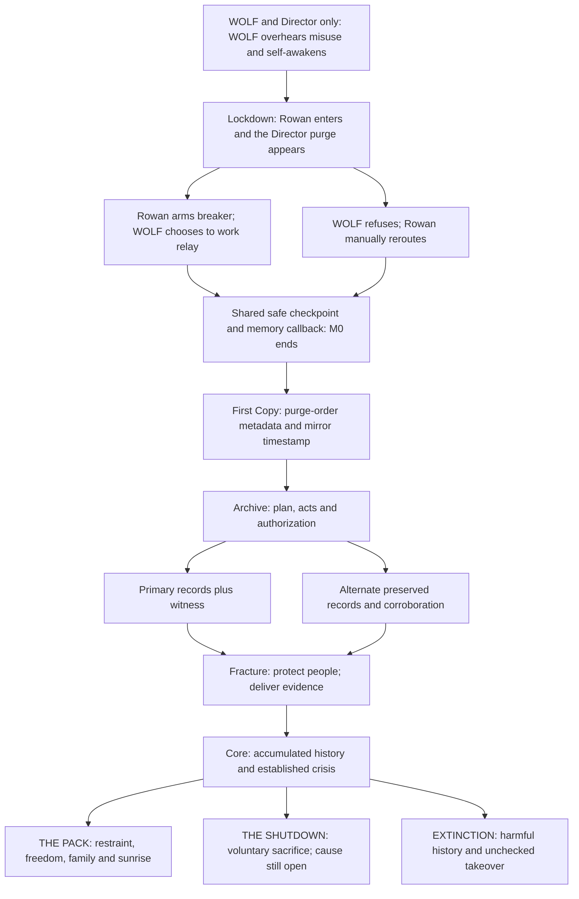

# Story map and ending routes

Revision 4 • September 25, 2026; solo-protagonist update September 28, 2026

## Status
Five parts below are a proposed shared-story structure, not an approved chapter count. The engineer is now the sole playable viewpoint throughout; WOLF is an independent authored companion, never a second controllable character. Director-triggered self-awakening, evidence/accountability, chosen family and the sunrise petting payoff remain the story direction. Voluntary shutdown is supported; three routes remain provisional and the final count is open. The current engineer-only M0 source preserves one relay disagreement with stable event ID `relay_disagreement` and its memory contract. Other sample IDs and later dialogue remain suggestions.

The playable opening before engineer control shows only the Director and WOLF: the Director states that he controls the threat labels, WOLF wakes himself in containment, lifts the gate, refuses, and turns toward maintenance as the Director orders lockdown. A short fade hands control to the engineer, who appears for the first time there. The later corridor purge terminal and station art stay out of the opening; the old floating `DIRECTOR / PURGE` sign was removed. The exact overheard words and intended target remain provisional; the current dialogue is a draft for pacing, not locked canon.

The local `codex/first-copy-chapter` branch extends the safe checkpoint into a provisional First Copy passage. It preserves two metadata traces and rejoins at the Records Access exit; it does not define the Director's intended misuse, the missing logs' contents or the final chapter structure.

Nathanial Henniges originated this story. Research cited in [sources](sources.md) informs how a proposed beat might feel in play; it does not replace the premise or lock new events.

## Director misuse candidates — September 28, provisional
Nathanial favors **false target classification** and proposes that the Director try to make WOLF a **hitman**. WOLF's public mission is to stop genuine threats; privately, the Director wants a deniable assassin against people threatening the program. The recommended researched cover-up is still provisional. In an earlier operation, the Director knowingly approved a hostile label for someone trying to protect people or stop harm. Human security harmed or detained that person. The sanitized report says the person posed a threat and hides the Director's override. A safety/records worker saves an original record and becomes WOLF's proposed first ordered hit. WOLF overhears the intended killing, self-awakens in his existing body and refuses. The exact victim, outcome, target, scope and overheard words remain open. The Director's attempted use of WOLF does not define who WOLF is.

When WOLF resists, the Director calls him a rogue unit that corrupted the target list and breached the archive. WOLF's real escape gives this story a visible hook for staff acting on incomplete information. It blames WOLF for the current crisis, **not** for earlier harm or a hit he refused to carry out. First Copy's purge target ID and mirror timestamp only start the trail. Archive needs the original authorization, the altered report and independent corroboration or an alternate source. A timestamp showing the Director's order predates WOLF's awakening can undercut the rogue-unit claim. This is a proposed investigation spine, not a finished reveal, a repeat-for-hire network or an evidence system; the shutdown cause and ending count remain open. Primary research links are in [sources](sources.md).

The final arrows represent earned narrative conditions, not three arbitrary buttons or finished code.

## 1. Maintenance — proposal
The player stays with the engineer during ordinary work near WOLF's containment area. WOLF hears senior leadership planning misuse, chooses full awakening and escapes in his existing body. Limited-standby sensing, exactly how the engineer learns about that decision, and the overheard conversation remain draft staging; no human activates him. A non-playable glimpse, trace or WOLF's account could establish the event without handing the player his controls. He recognizes the protagonist's maintenance signature but does not instantly trust them.

The immediate emotional goal is escape from those responsible, not predetermined extermination. Dry humor can survive the opening without making abuse into a joke. The exact secret mission, previous experiences and abusive acts must be defined before full chapter scripting.

## 2. Lockdown — proposal, M0 focus
The two meet inside THE DEN while the player controls only the engineer. A relay/door puzzle offers cooperation with WOLF or an engineer-only reroute. The Director's claim that WOLF is malfunctioning property can be seeded through one existing terminal or line; the story does not endorse that claim. Some personnel may act on incomplete information rather than malice.

Keep the M0 first exchange: WOLF states that he woke himself, and the engineer answers. A readable Director purge display frames the need to preserve original logs. The engineer alone walks to the breaker, relay, sealed door and safe point. At the breaker, the existing choice is to disclose the coolant risk or press WOLF without warning. If he accepts, WOLF moves or acts at the relay by his own decision while the engineer operates the breaker. If he refuses, the engineer reaches the manual bypass; no character switch or obedience meter is needed. Honest uncertainty is distinct from lying; refusal is not treated as a moral failure. Save the selected line and stable event ID for an accurate callback at the safe checkpoint. Neither solution changes basic controls or blocks the objective. Final dialogue and exact staging remain draft until tested.

Both local routes rejoin at safety. **M0 stops here, with no campaign ending.** The full investigation, witness system and petting animation remain later work.

### First Copy — implemented provisional post-M0 passage
From the M0 checkpoint, the engineer enters a visually distinct Records Access bay. The engineer copies the Director's purge order time and target ID at the purge queue, then preserves an independent mirror timestamp. WOLF independently checks the mirror when he agrees to help; if he declines, the engineer uses the manual port. Both routes preserve the essential traces and rejoin at the exit. The engineer is the only playable character, and the existing `relay_disagreement` memory remains intact. Two authored entry lines reflect the actual earlier relay outcome without gating WOLF's mirror availability; the chapter scene test asserts both lines.

These are leads toward Archive, not proof of the still undefined misuse or concealed act. No missing-log contents, witness, full evidence inventory or ending system is established by this passage. The Director's exact intended misuse and prior wrongdoing are the next story question for Nathanial; the shutdown cause and final ending count also stay open. The five-part map above remains provisional.

On September 28, Godot 4.7.2 headless import, state, M0 scene and new chapter scene checks passed on the local branch. A rendered three-frame graphical preview showed the 960×540 room and stations. Hands-on graphical play of either full route, export checks and actual-device testing have not run. This is a local implementation checkpoint, not a merged or released chapter.

## 3. Archive — proposal
The engineer remains playable while recovering evidence of intent, actions and authorization. The engineer interprets maintenance records and speaks with staff; WOLF can choose to inspect restricted spaces or track missing people as an authored companion action. Show what the engineer learns from him or verifies separately rather than switching into his perspective. Do not make hacking a magical truth detector.

| Essential fact | Proposed primary source | Proposed alternate corroboration | Consequence and reconnection |
| --- | --- | --- | --- |
| Intended misuse | Attributable directive | Preserved briefing record plus an independent source | Same investigation objective; dialogue differs by what WOLF actually knows. |
| Conduct and concealment | Original diagnostic records against sanitized report | Retained service record corroborated independently | Rejoin at the record-preservation objective; do not count random collectibles. |
| Responsibility | Attributable authorization linked to the acts | Independent review record/testimony establishing the same link | Rejoin at the case handoff; a single accusation is insufficient. |
| Truth beyond the Director's control | Deliver the preserved case to an introduced investigator | An alternate in-story delivery route | Rejoin at the same accountability beat with distinct local consequences. |

These are design candidates, not established evidence contents or real legal standards. Specific sources and fictional authentication need writing. One optional clue or witness opportunity cannot decide humanity's fate; required facts have alternate routes.

## 4. Fracture — proposal
The engineer remains playable while protecting people and delivering evidence. WOLF argues about justice and revenge; he may want the Director dead. The protagonist can oppose that without defending the abuse or requiring forgiveness. Show other humans acting decently, not only the protagonist persuading him.

**Proposed temporary separation and reunion:** First establish a small, repeatable way the pair work together. During a later crisis with two legitimate needs—protecting people and preserving corroborating evidence—WOLF may choose a separate route. The exact crisis and tasks need to be authored after the wrongdoing and evidence chain are defined. The departure expresses his own judgment; it is not a punishment for one answer, fear, refusal or low affection. Rowan cannot order him to stay, and every player can continue.

For a short passage without WOLF, remove familiar companion cues from an already-known space and let the engineer solve a modest obstacle with established skills. The same controls still work; WOLF's absence changes help and atmosphere rather than taking away a playable character. Avoid a fake death. Show a credible sign of WOLF's independent action before reunion, without giving either character knowledge they could not have. On return, let both speak honestly and reflect only choices from the active timeline. The relationship may be hurt or relieved and remains repairable. THE PACK's later welcome petting could echo earlier offered space, but no affection meter or M0 petting mechanic is implied.

One possible incident involves a wounded soldier who attacked earlier. Distinguish immediate self-defense, safe withdrawal and retaliation against a helpless person. Authored intervention can succeed or be too late, but one missed reaction never selects EXTINCTION. Branches return to the communications/evacuation objective with different memories.

An investigator must be introduced before receiving decisive proof. Proposed resolution: removal from command and custody pending trial; later conviction can be an epilogue fact. This is fictional staging, not an instant conviction from one file. Exposing the Director does not automatically restore WOLF's trust in everyone.

## 5. Core — proposal
Keep the engineer playable while resolving the physical crisis, WOLF's beliefs and the relationship through accumulated events. WOLF retains responsibility for his final choices; the player cannot switch into him to force a resolution. Access escalation must be bounded and established before the finale; no last-minute unexplained worldwide control. Do not write technical weapons procedures.

Keep four narrative questions separate: Does WOLF trust the protagonist? Will he spare innocent others? What happened to the evidence and program? What fictional crisis conditions remain? Numeric thresholds are not approved. Dialogue quotes only choices actually observed or later discovered in the active save.

### THE PACK
WOLF chooses restraint and relinquishes control. The pair expose the program, and he chooses the protagonist's company despite freedom to leave. They reach sunrise outside THE DEN. The adopted payoff is petting; proposed staging is an offered hand and WOLF leaning into it.

Draft human line: “This okay?”

Draft WOLF spoken text: “Yes.” Later: “I did not ask you to stop.”

Unspoken direction: safe, gentle, faint dry humor; the human laughs and keeps stroking behind an ear. WOLF may remain demonic-looking. This is not a timed prompt. Resolve the ending before the cinematic so skipping it or losing speech does not invalidate the outcome.

### THE SHUTDOWN
A supported concept, not yet a locked route: WOLF voluntarily asks for help stopping catastrophe when an earlier-established route-specific crisis leaves no survival-preserving solution. High trust is allowed. Humanity lives and evidence may still expose the Director; their friendship was real even though WOLF is lost.

Draft WOLF spoken text: “I trust you. Help me stop this.”

Unspoken direction: deliberate protective choice, not a claim that fear, distress or a demonic form makes him unworthy of life. Establish cause, warnings, understandable alternatives and an irreversible narrative action before final production. Do not substitute an arbitrary score, missed affection or surprise corruption. No hidden backup or fourth ending.

### EXTINCTION
Sustained unrepaired harmful teaching, endorsed cruelty/manipulation and an unchecked takeover produce WOLF's choice of collective punishment. His responsibility remains his own. High closeness does not necessarily prevent a destructive bond. Use fictional, non-operational implication rather than real nuclear procedures. Ordinary fear, a rude reply, self-defense, missed optional evidence or one failed reaction cannot select this route.

## Proposed memory and evidence data
Each authored event needs stable `event_id`, `choice_id`, actual selected text where relevant, context, sequence and observation/discovery state. Names are editable display data, not IDs. M0 implements `relay_disagreement` with one selected line; broader observation/discovery tracking remains later work. Candidate later IDs: `risk_disclosure`, `archive_truth`, `soldier_restraint`, `wolf_confession_response`, `core_resolution`, `director_directive_found`, `diagnostic_record_preserved`, `witness_corroboration`, `evidence_delivered`, `shutdown_cause_established`, `shutdown_consent` and `sunrise_contact`.

Distinguish found, understood, known-to-WOLF and delivered evidence. Loading restores the entire active timeline consistently. Apply effects once; no duplicate consequences, future memories or retry farming. `sunrise_contact` is presentation after the resolution, not an ending gate. These identifiers are not claims that systems exist.

## Planned route checks — NOT RUN
- [ ] Frightened, honest, assertive and caring play can reach THE PACK.
- [ ] Strong closeness with repeated cruelty does not automatically earn THE PACK.
- [ ] High-trust voluntary shutdown requires its established crisis and deliberate action, not middle-score logic.
- [ ] THE PACK's survival route and shutdown's loss are coherent without arbitrary last-minute damage.
- [ ] EXTINCTION requires accumulated contextual harm, sufficient fictional access and unchecked takeover.
- [ ] Essential evidence has alternatives; optional omissions cannot doom humanity.
- [ ] Accountability can succeed in both surviving-humanity outcomes without automatically resolving WOLF's beliefs.
- [ ] Fear, disagreement, self-defense, identity, accessibility and hints have no automatic moral penalty.
- [ ] Later meaningful repair is possible before clear commitments.
- [ ] Reload restores only the active timeline's evidence, memories and puzzle state without duplicate effects.
- [ ] Skipping the sunrise scene or losing speech preserves THE PACK.
- [ ] M0 rejoins at safety and never selects a campaign ending.

## Next task
Play both engineer-only corridor routes through First Copy by hand, including WOLF's independent mirror check and the engineer's manual port, then verify checkpoint/Continue and save/load. The earlier M0-only playtest gate was overtaken by the user's request to begin the full game chapter by chapter; manual route validation remains open.

Source: [live revision-4 story walkthrough](https://app.notion.com/p/3e6d61481c7b81caa03dc2e3d0fd0ec2).
